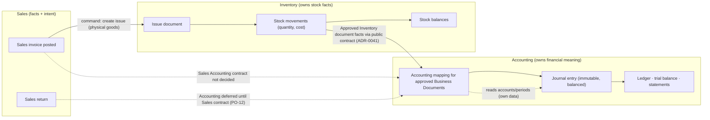

# Accounting Domain Analysis

Status: Proposed (design for review) · Updated: 2026-10-07 (C-61 boundary decisions linked)
Companion: [blueprint](./domain-blueprint.md) §9 · [glossary](./domain-glossary.md) ·
ADR-0041 (synchronous Inventory → Accounting contract), ADR-0017 (inventory ledger),
AR-13/16 · [PDR-09](../../decisions/product/PDR-09-inventory-accounting-posting-boundary.md) ·
OQ-23, OQ-24, OQ-25, OQ-30, OQ-39, OQ-70, OQ-72

> **Superseded in part (2026-09-14, Task 10.1).** This file remains the *conceptual
> options analysis* (chart-of-accounts options, fiscal-calendar options, posting-rule
> illustrations, expert-gate list). The **binding domain contract** — bounded context,
> financial area, fiscal year/period model, configurable coding structure, detail
> dimensions and floating detail, document shape, lifecycle and correction mechanisms,
> the source-posting contract, numbering, reporting boundary, invariants and gates — is
> [`docs/accounting/domain-contract.md`](../../accounting/domain-contract.md), decided
> in [ADR-0026](../../adr/0026-accounting-bounded-context.md) (Proposed). Where the two
> differ on structure or ownership, the contract and ADR-0026 win; where the contract
> marks a rule EXPERT-GATED, the questions in §8 below are still the ones to answer.

> **C-61 current decision overlay (2026-10-07).** For Inventory → Accounting,
> [PDR-09](../../decisions/product/PDR-09-inventory-accounting-posting-boundary.md)
> and [ADR-0041](../../adr/0041-synchronous-inventory-accounting-application-contract.md)
> supersede the event-subscription mechanism described in older analysis below.
> The posting call is synchronous through a public application/domain contract;
> C-61 does not implement it. Only approved Business Documents may initiate it,
> Inventory owns valuation facts, and Accounting owns mapping/journal policy.
> Illustrative rows below are not additional Owner decisions. Sales Accounting
> and the OQ-70 Purchase Return variance policy remain undecided/deferred as PDR-09 states.

> **Expert boundary (explicit).** The project owner does not have formal accounting
> expertise. This document is a *conceptual* analysis: it frames the decisions,
> compares options and states what must not be built before an accountant (and where
> relevant, a tax expert) signs off. **Nothing here is an accounting rule.** Each
> subsection marks items as *expert-gated*.

---

## 1. What Accounting owns (and what it must not own)

| Accounting owns | Accounting must not own |
|---|---|
| Chart of accounts, journals, periods, fiscal calendar | Stock quantities (Inventory) |
| Accounting mapping/journal policy for approved Business Document facts (AR-16, PDR-09) | Document lifecycles (owning modules) |
| Posting, reversal, period close | Pricing/tax computation on documents (Sales/Purchasing, expert-gated) |
| Financial statements & ledger inquiries | Whether a warehouse may go negative (Inventory policy) |
| Accounting mapping/journal policy over Inventory-supplied valuation facts (PDR-09; OQ-24) | Inventory valuation method/calculation and movement quantities (Inventory; PDR-05 / PDR-09) |

For Inventory → Accounting, the current Owner-approved boundary is PDR-09 / ADR-0041:
Inventory supplies valuation facts for an approved Business Document through a
synchronous public application/domain contract, and Accounting decides the financial
mapping. No event subscriber or cross-module table access implements this today.

---

## 2. Chart of accounts — options and recommendation

| Option | Description | Pros | Cons | Fit for Vardena |
|---|---|---|---|---|
| **1. Fixed system chart** | One standard account list, code-defined, not editable | Simplest code and reporting; consistent across deployments | Businesses have statutory/legacy charts they cannot abandon; every deviation becomes a hack | Rejected as the only option |
| **2. Standard template + organization customization** | Ship a template skeleton; organizations may add/rename accounts below fixed control points | Fast onboarding; statutory blocks guaranteed; still flexible | Template must be maintained; customization surface needs rules | **Recommended (hybrid)** |
| **3. Fully organization-defined chart** | Organization creates every account freely, including control accounts | Maximum fidelity to each business | Posting rules cannot rely on stable control accounts; automated reports and mappings become per-customer configuration; high support cost | Rejected |
| **4. Hybrid: code-defined control structure + configurable detail** | Control accounts (receivable, payable, inventory, tax, COGS, cash…) are code-referenced by posting rules; the detail accounts, codes and hierarchy below them are organization data | Automated posting is possible without knowing the customer; organizations keep their own coding; statutory report structures can be mapped | Requires discipline: control-account semantics are not editable; mapping rules must be tested per organization | **Recommended** |

**Recommendation: option 4 (hybrid).** Concretely:

- The system defines a small set of **control roles** (e.g. `receivable`, `payable`,
  `inventory`, `cogs`, `tax_payable`, `revenue`, `cash`, `bank`, `opening_equity`) as
  code identifiers. Posting rules reference *roles*, not account codes.
- Each organization maps its accounts to those roles **once**, as configuration.
- The account tree below/above the roles is organization data: code, name,
  parent/level, type (asset/liability/equity/revenue/expense), postable flag,
  currency constraints, active flag.
- Reporting/statutory layouts map their lines to account ranges/roles, so a customer
  can use their own coding without breaking the built-in statements.

**Expert-gated (OQ-25):** the account-type taxonomy and levels, the coding scheme
(numeric segments, meaning, length), which control roles are mandatory, whether
organizations may add levels, statutory report formats, and whether the Iranian
standard chart (as applicable) should ship as the default template.

**Data-shape implications to freeze before implementation:** account code format
(max length, separators, uniqueness scope), hierarchy representation (parent FK +
materialized level depth vs path), whether an account may change parent/type after
postings exist (**recommendation: no** — create a new account and deactivate the old
one), and whether dimension defaults live on accounts.

---

## 3. Fiscal calendar and periods

| Aspect | Options | Recommendation | Expert? |
|---|---|---|---|
| Year definition | Gregorian fiscal year; organization-defined start; Jalali-aligned fiscal year | **Organization-defined start date** (a fiscal year is a configured row), so both Gregorian and Iranian calendars are expressible without code assumptions (OQ-02/OQ-23) | Yes |
| Period granularity | 12 months; 12 + adjustment period; 4-4-5; 13 periods | Start with **configurable monthly periods + optional adjustment period**; the schema stores period rows, so other layouts are data | Yes |
| Period status | open/closed only; open/soft-close/hard-close | **open / closed** in v1, with `locked` semantics documented, because soft-close rules are policy (expert) | Yes |
| Posting into closed periods | reject always; allow with special permission; allow with reversal-dated entry | **Reject by default**; any override is a policy decision (expert) | Yes |
| Closing entries | manual; generated rule | Manual closing documents in v1; automated year-end is an expert-driven feature later | Yes |
| Reopening | never; with permission + audit | **With permission + audit** (a business needs it for corrections), but the policy must be written down | Yes |
| Opening balances | per-account entry; imported from legacy | **Explicit opening journal(s)** dated before live operation, permission-gated, with an import path (Excel) | Yes |

The schema consequence that must be frozen early: journals carry `fiscal_year_id` and
`fiscal_period_id` (in addition to the date), assigned at posting time by the
calendar service — so reporting never recomputes periods from dates.

---

## 4. Journals, posting rules and dimensions

- **Journal entry (voucher):** header (number, date, period, description, source,
  status, reversal link) + lines (account, debit, credit, currency, exchange rate,
  cost centre, project, branch, partner?, quantity? for statistical entries).
- **Invariants (core, not configurable):** debits = credits per entry (in base
  currency); entries are immutable once posted. For Inventory, PDR-09 requires
  operation-key + request-hash idempotency; an event id is not the primary posting key.
  Accounting correction/reversal policy remains open (OQ-27/OQ-39/OQ-42).
- **Posting rules** (Accounting-owned code + organization mapping data): for an
  explicitly approved Business Document type, which control roles are debited/credited,
  how amounts are derived from supplied facts, and which dimensions are propagated.
  Example shape only (illustrative — **not a source-approval or accounting-rule
decision; the actual mapping is expert work**):

  | Illustrative source (not an approval) | Debit | Credit | Notes |
  |---|---|---|---|
  | Sales invoice (future Sales contract required) | receivable (total) | revenue (net) + tax payable (tax) | No Sales Accounting mapping approved by C-61; rounding expert-gated |
  | Inventory Receipt Business Document (if later approved) | inventory (cost) | goods-received/clearing | Source eligibility and account/offset mapping are open |
  | Inventory Issue Business Document (if later approved) | COGS (cost of movements) | inventory (cost) | Inventory supplies authoritative valuation; COGS/journal policy remains open (OQ-24) |
  | Purchase Invoice (future Purchasing contract required) | expense or inventory | payable (total) | Purchasing not in C-61; tax handling expert-gated |
  | Payment/receipts | cash/bank | receivable / payable | Later module; no C-61 decision |

- **Dimensions:** account + cost centre + project + branch are stored on lines (typed
  columns) so ledger reports group and total in SQL. Whether cost centre and project
  are mandatory per account is **per-account configuration**, expert-gated.
- **Reversal:** a reversal creates the mirrored entry linked via `reverses_entry_id`;
  both remain (AR-13). Whether a reversal can cross closed periods is expert-gated.
- **Immutability window:** whether posted entries can be corrected by reversal without
  extra approval, and for how long, is a policy decision (OQ-27, expert).

---

## 5. Accounting effects of the operational domains

| Domain | Effect | Owned by | Expert questions |
|---|---|---|---|
| Inventory receipt (purchase) | Inventory fact plus a separately decided financial effect | Accounting mapping through the approved synchronous public contract (PDR-09 / ADR-0041) | Account/offset content, landed cost, tax and other OQs; no rule implemented |
| Inventory issue (sale) | Inventory fact plus a separately decided financial effect | Accounting mapping through the approved synchronous public contract (PDR-09 / ADR-0041) | COGS/offset content and timing (OQ-24/25/39); no rule implemented |
| Inventory adjustment | No automatic posting rule assumed | Requires an explicitly approved Business Document and Accounting contract | Eligibility and account policy are not decided here |
| Sales invoice | Revenue/receivable policy not established by C-61 | Separate Sales Accounting contract required | Revenue recognition timing, discounts, tax and source authority remain outside C-61 |
| Sales return | Inventory effect may exist independently; Accounting posting is deferred | No Sales Accounting contract yet (PO-12 / PDR-09) | Do not invent revenue, receivable or cost reversal rules |
| Purchase invoice | Purchase-side financial effect not established by C-61 | Separate Purchasing/Accounting contract required | Expense vs inventory capitalization; three-way matching |
| Payment/receipts | Cash/bank vs receivable/payable | Later module | Bank reconciliation, cheque handling (Iran-specific, expert) |
| Same-Legal-Entity warehouse transfer | **No GL Voucher**; Inventory transfers the source Issue value to the destination Receipt unchanged (PO-06) | Inventory valuation contract; no Accounting Voucher | Intercompany/different-entity, tax and financial-area cases remain open (OQ-31) |
| Tax | Tax payable/input tax | Accounting mapping; tax computation on documents | OQ-30 — tax expert |

The pattern is the same for purchasing (order → receipt → purchase invoice), with
Inventory owning the receipt and Accounting owning the payable/expense meaning.

**Rule:** no posting mapping is invented in Inventory/Sales code. For Inventory,
Accounting mapping applies to explicitly approved Business Documents and is invoked
through the synchronous public contract (ADR-0041); it is not an event subscription.
C-61 implements nothing and does not enable posting. Sales Accounting, including
Sales Return posting, remains outside this decision package until its own contract
exists. The product can continue Inventory operations without an Accounting effect.

---

## 6. Reporting implications

- Trial balance, ledger, P&L, balance sheet are queries over journal lines grouped by
  account (and dimensions) with period/date filters; **no report recomputes**
  accounting from documents.
- Because periods are stored on entries, "as of period" reports are predicates, not
  date arithmetic.
- Because dimensions are typed columns, "P&L by cost centre/project/branch" is a
  `GROUP BY`, and "inventory value by warehouse" is a join between valuation state
  (Inventory) and its account (Accounting) through reporting views (ADR-0009).
- Statutory report **layouts** are expert-gated (they differ by jurisdiction).

---

## 7. Anti-patterns avoided

| Temptation | Why avoided |
|---|---|
| Computing balances from documents at report time | Slow and ambiguous; the ledger is the fact table |
| Editing posted entries | Destroys audit and legal defensibility (AR-13) |
| Free-text account codes with no control-account semantics | Automated posting becomes per-customer code |
| Accounting logic inside Sales/Inventory | Violates AR-16 and duplicates rules per module |
| Storing tax rates/currency rates inside code | Rates change; history must remain reproducible (effective dating) |
| Multi-currency design invented ad hoc | Currency/precision is OQ-03; expert input required |
| "Ledger in JSONB" | Reporting and integrity collapse |

---

## 8. Requires domain-expert validation (accounting-specific)

1. Chart-of-accounts template content, coding scheme, levels, control roles (OQ-25).
2. Fiscal year start/period structure and the close/reopen policy (OQ-23).
3. Posting mappings per explicitly approved Business Document, including which dimensions are mandatory (OQ-25); C-61 approves no Sales Accounting rule.
4. Accounting treatment of Inventory valuation (COGS/journal mapping, landed cost, precision/currency, write-down/NRV and remaining adjustment policy: OQ-24). Inventory's MVP valuation method and Inventory return-costing conventions are recorded in PDR-05/PDR-08; agreed Purchase Return variance policy is OQ-70.
5. Tax computation model: rates, inclusive/exclusive, rounding, exemptions (OQ-30).
6. Revenue recognition and discount treatment on invoices/returns (expert).
7. Opening balances and migration from the legacy ERP (OQ-04 area, expert).
8. Reversal/correction windows and their legal meaning (OQ-27).
9. Inter-branch or inter-company settlement and internal-account usage (OQ-31).
10. Statutory report formats and any required registers (expert).

## 9. Decisions introduced here

- **D-03** Accounting owns the calendar, journals, mapping and closing; the ledger is
  immutable; corrections are reversals (existing AR-13/16 reaffirmed).
- **D-12** Chart of accounts = hybrid (code-defined control roles + organization-owned
  detail), ADR-0020/§2; expert-gated details in OQ-25.
- **D-19** Accounting can be **disabled** per organization while operational modules
  ship, so undecided accounting rules never block non-financial ERP use.
