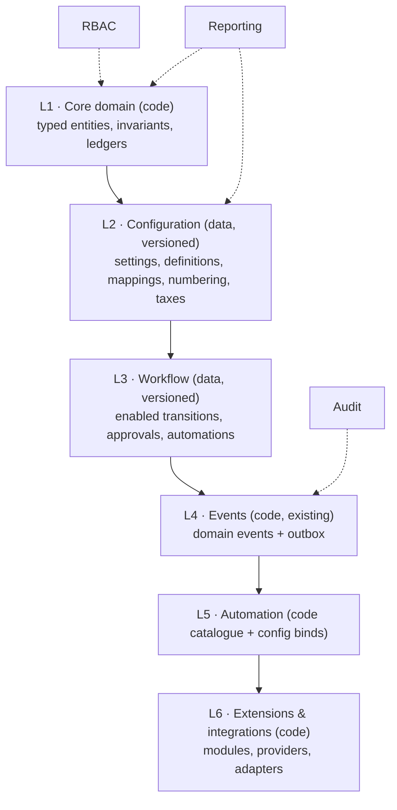

# Configurability Architecture

Status: Proposed (design for review) · Updated: 2026-09-11
Companion: [blueprint](./domain-blueprint.md) §14–§16 · [workflow](./workflow-architecture.md) ·
ADR-0018 (proposed) · ADR-0013 (user preferences) · OQ-28 · AR-06/13/24/31

This document specifies **how** Vardena achieves business flexibility: what
configuration is, where it lives, how it is versioned, what it may change, and where
customization stops.

---

## 1. The flexibility layers

| Layer | What changes here | Who changes it | Versioning |
|---|---|---|---|
| L1 Core | Business facts (item, movement, journal, document, party) | Code + migration (AR-10), ADR when structural | Schema migrations + ADRs |
| L2 Configuration | Values and definitions that parameterize behaviour | Organization admins (permission-gated) | Effective-dated rows; immutable history where it affects interpretation |
| L3 Workflow | Which code-defined transitions are enabled, approvals, automation bindings | Organization admins | Versioned + published (ADR-0018) |
| L4 Events | — (facts) | Nobody | Event schemas versioned with code |
| L5 Automation | Binding a registered action to a trigger with typed parameters | Organization admins | Stored in the workflow/config version |
| L6 Extensions | New modules, providers, adapters | Developers (code + ADR) | Application releases |

The layers are ordered by **change frequency and audience**: the deeper the layer, the
more engineering control it requires. This is how "configurable without a codebase per
customer" is achieved *and bounded*.

---

## 2. Configuration taxonomy

| Kind | Examples | Storage shape | Effective dating? |
|---|---|---|---|
| **Scalar settings** | default branch, tax-inclusive display, accounting enabled | key/value-per-organization settings row (typed columns for known keys, not free JSON) | No (immediate, audited) |
| **Numbering series** | invoice/order/receipt number formats, scopes | rows per (document type, scope, series) | `valid_from` (a series change must not renumber history) |
| **Tax definitions** | tax groups, rates, exemptions | rows + `valid_from/valid_to` | Yes |
| **Account mapping** | control role → account per organization | mapping rows, versioned when used by posted entries | Effective-dated; posted entries store the mapping version |
| **Price lists** | item prices per customer group/branch | rows + `valid_from/valid_to` | Yes |
| **Templates** (print/letterhead) | document layouts | Print module tables (ADR-0012) | Versioned templates |
| **Custom-field definitions** | extra descriptive fields per entity | definition registry rows | Definitions versioned; values stored per record |
| **Workflow definitions** | transitions/approvals/automations | definition + version tables | Yes (ADR-0018) |
| **Required-field policy** | which *code-supported* fields are mandatory per document type | rows per document type/field | Effective-dated with the workflow version |

> **Inventory negative-stock boundary:** physical negative inventory is rejected for
> the MVP (OD-VAL-17 / PDR-05); an allowance is not an Organization configuration
> choice. Legacy Item/Warehouse allow overrides remain in code and are recorded in
> C-61 as an implementation discrepancy, not an approved configurability rule.

**Anti-pattern guard:** configuration never stores **free-form business logic**
(scripts, SQL, conditions beyond the supported vocabulary). If a business needs a rule
Vardena cannot express, that is a product gap to design — not a hole to open.

---

## 3. Where configuration lives (ownership)

- The proposed **`organization` module** owns configuration (ADR-0020): settings,
  numbering, taxes (reference data), workflow definitions, required-field policy.
- Configuration is stored in the `organization` schema; other modules read it through
  the Organization module's public service (AR-07) — they do **not** read its tables.
- Per-user preferences (UI/table/dashboard/filters) remain in **Customization**
  (ADR-0013) and are explicitly **not** business configuration.
- Some configuration is intrinsically module-owned and stays there: print templates
  (Print), report saved views (Customization), integration destinations (Integration).
  The Organization module holds *cross-module* configuration only.

---

## 4. Versioning & effective dating (the historical-integrity contract)

**Problem.** If a company changes its invoice workflow, tax rate or account mapping
tomorrow, yesterday's documents must keep their original meaning.

**Rules:**

1. **Immutability of used versions.** Any configuration consumed by a document,
   movement or journal is referenced by version/id from that record:
   - document → `workflow_version_id`;
   - journal line → `mapping_version_id` (or the mapping snapshot);
   - document line → `tax_rate_snapshot` (value, not just id);
   - movement → valuation method state reference where relevant (ADR-0017).
2. **Effective dating.** Configuration rows that interpret the future carry
   `valid_from`/`valid_to`; updates create a new row and close the previous one
   (`valid_to = new.valid_from − ε`), never an in-place overwrite of a used row.
3. **Publication workflow.** Complex definitions (workflow versions, required-field
   policy) have `draft` → `published` → `superseded`. Publishing is permission-gated
   and audited; drafts are invisible to production behaviour.
4. **Scope.** Configuration is organization-scoped by default; branch-scoped only
   where the concept is inherently local (numbering, letterheads, warehouse policy).
   Overriding at the branch level is explicit, not implied.
5. **Migration of in-flight records.** Changing configuration never rewrites open
   documents silently. If a business wants open documents moved to the new version,
   that is an explicit, audited bulk action with a report of what changed.
6. **Point-in-time reproducibility.** Because versions are referenced and dated, an
   auditor can answer "which rule applied to this document?" and reports can reproduce
   historical behaviour (e.g. the tax rate on an invoice date).

---

## 5. Custom fields (JSONB) — policy

**Goal:** allow a business to record descriptive extras without turning Vardena into
EAV/JSONB.

### 5.1 Allowed

- A **registry of custom-field definitions** (per organization): code, entity type,
  label, data type (text/number/date/boolean/select), options, required flag,
  validation hints, active flag.
- A single `custom_fields jsonb` column on a **whitelisted** set of entities:
  `parties`, `items`, `warehouses`, and (later) document **headers** only.
- Server-side validation on write against the registry (types, ranges, options), with
  unknown keys rejected (AR-24).
- GIN indexes only for a concrete, documented query — none planned in v1.
- Values are included in exports/prints on request; the definition registry drives
  labels and formats.

### 5.2 Forbidden

- Any **amount, quantity, tax, currency, date used for accounting periods, status,
  dimension (warehouse/cost centre/project/partner/item)** in JSONB.
- Custom fields on **journal lines, stock movements, document lines** — the ledger
  facts must stay typed and reportable.
- Using custom fields to satisfy a legal/statutory requirement. If a law requires a
  field, it is a **core column** with a migration.
- Custom fields participating in **filtering/grouping in standard reports**; only
  explicitly designed list filters may expose them (query must be indexed).

### 5.3 Promotion path (custom → core)

1. A field proves valuable (used in queries, reports, validations) or becomes legally
   required.
2. Add a real column + migration (AR-10), backfill from JSONB, update the definition
   registry to hide the custom field.
3. Reports/filters switch to the typed column.

**Governance:** custom-field definitions are configuration with permissions
(`Organization.CustomField.Manage`); enabling them requires the registry schema
(§5.1) to exist first — which is why the first migration includes the registry, not
just the column.

---

## 6. Business-rule categories and where they are implemented

| Category | Nature | Implementation | Configurable? |
|---|---|---|---|
| **Domain invariants** | Meaning of the data (balanced entries, immutability, positive quantities where required) | Code + DB constraints | No |
| **Organization configuration** | Values (fiscal calendar, policies, defaults, feature switches; not the fixed Jalali-first display calendar) | Configuration tables + Organization service | Yes |
| **Workflow rules** | Which enabled transitions require what | Workflow definition versions | Yes |
| **Validation rules** | Field/DTO validation, capability constraints, required-ness | DTO/domain code + required-field policy | Partly (required-ness over code-supported fields) |
| **Automation rules** | Reactions to transitions/events | Action catalogue (code) + bindings (config) | Yes (within catalogue) |
| **Accounting rules** | Approved Business Document facts → journal mapping and recognition (Inventory valuation itself remains Inventory-owned) | Accounting mapping data + expert-approved code, invoked through public contracts | Organization mapping yes; rules expert-gated |
| **Integration rules** | Destinations, retry, payload versions | Integration configuration | Yes |

**No universal rules engine.** A general expression language or user-authored scripts
is rejected because it is unreviewable, untestable, a security surface, and it makes
reporting/audit impossible to guarantee. Every configurable rule is designed with its
read-set, action-set and validation before exposure.

---

## 7. Reporting implications of configurability

- Configuration tables are reportable like any other typed data: "which document used
  which workflow version", "tax collected per rate", "documents per numbering series".
- Because configuration is effective-dated and referenced, point-in-time reports are
  possible without reconstructing historical configuration from logs.
- Custom fields never become reporting dimensions by accident (§5.2); a field that
  must be reported on goes through promotion.
- Report definitions stay code (ADR-0009); configuration may save *views/filters*
  (Customization) but never SQL.

---

## 8. Risks specific to configurability

| Risk | Mitigation |
|---|---|
| Configuration becomes an unversioned "settings soup" | Every kind in §2 has a defined shape, owner and versioning rule |
| Environment drift (dev vs prod configuration) | Configuration export/import + reviewed configuration change (deployment tooling, R3) |
| Over-configuration (every business rule as a config knob) | Each new knob needs a design: read-set, action-set, validation, reporting consequence |
| Custom fields used as a shadow schema | Registry + whitelist + promotion path + review gate |
| Historical documents reinterpreted | Version references + effective dating + pinning (§4) |
| Users bypassing permissions on configuration endpoints | Standard AR-21/AR-22 guard + application-service checks; configuration changes emit audit events |

## 9. Decisions introduced here

- **D-20** Configuration is organized in layered, typed, versioned definitions owned by
  the Organization module (ADR-0020), read through its public service.
- **D-21** Effective dating + version pinning is the historical-integrity mechanism;
  in-place edits of used configuration are forbidden.
- **D-22** Custom fields are limited to a registry-governed JSONB column on a
  whitelist of entities, with a documented promotion path (OQ-28 confirms scope).
- **D-23** No universal rules engine; rule categories are implemented in code with
  narrow configuration surfaces.
