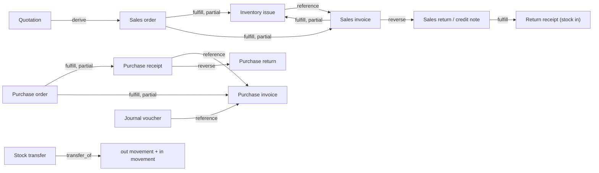

# Business Document Architecture

Status: Proposed (design for review) · Updated: 2026-09-11
Companion: [blueprint](./domain-blueprint.md) §6–§7 · [workflow](./workflow-architecture.md) ·
ADR-0019 (proposed) · AR-03/04/12/13 · OQ-12, OQ-27

Documents are where the business actually happens. This document decides how Vardena
represents them: what is shared, what is specialized, how documents relate, and how
documents are cancelled or reversed — without building a universal document engine.

---

## 1. Requirements the model must satisfy

1. **Typed, validated, reportable documents.** Each document type has its own fields,
   validation and report shape; reports run in SQL over typed columns (ADR-0009).
2. **Uniform mechanics.** Numbering, status/transition history, attachments,
   relations, audit and printing behave the same for every type.
3. **Configurable flows.** Which documents exist in a process and in what order is
   configuration over code-defined types (see [workflow](./workflow-architecture.md)).
4. **Partial fulfilment.** An order is fulfilled by several issues/invoices; an
   invoice may issue from several orders. Remaining quantities must be reportable.
5. **Immutability after posting.** Posted documents are not edited; corrections are
   counter-documents (AR-13).
6. **Cross-module ownership.** Sales documents live in `sales`, inventory documents
   in `inventory`, journals in `accounting`; no shared document table (AR-07/08).
7. **No engine.** Configuration selects among code-defined documents, transitions and
   actions — it does not define new ones.

---

## 2. Options evaluated

| Option                                                                     | Description                                                                                                                                           | Pros                                                                                                              | Cons                                                                                                                                                                                   | Verdict                                                            |
| -------------------------------------------------------------------------- | ----------------------------------------------------------------------------------------------------------------------------------------------------- | ----------------------------------------------------------------------------------------------------------------- | -------------------------------------------------------------------------------------------------------------------------------------------------------------------------------------- | ------------------------------------------------------------------ |
| **A. Independent model per document type**                                 | Each type: its own header/lines/status/relations, no common mechanics                                                                                 | Total freedom per type                                                                                            | Numbering, status history, relations, validation and printing re-implemented N times and drift; cross-type reporting needs ad-hoc SQL per report                                       | Rejected (mechanics duplication is a defect source, not a feature) |
| **B. Shared foundation + specialized tables** (recommended)                | Typed tables per type + shared _mechanics_ (document number/date/status contract, transition history, relation table, numbering service, print hooks) | Type safety & FKs preserved; uniform behaviour; one place for numbering/relations/history; reports stay plain SQL | Some shared conventions must be maintained; a new document type must adopt the contract                                                                                                | **Recommended**                                                    |
| **C. Universal `documents` table with JSONB payload/lines**                | One table for everything, types are data                                                                                                              | "No migrations for new document types"                                                                            | Cannot enforce per-type invariants; no FK per line; every report extracts JSON; one table becomes the schema bottleneck for the whole ERP; permissions/validation become string-driven | Rejected                                                           |
| **D. Class-table inheritance** (a base `documents` table + subtype tables) | Shared header row + type-specific extension tables                                                                                                    | One identity space; shared header fields physically shared                                                        | Creates a cross-module shared table (violates one-owner-per-fact AR-08); deeper joins on every report; module extraction later becomes painful                                         | Rejected for a modular monolith with schema-per-module             |

**Decision: Option B.** "Shared foundation" is a set of _contracts and mechanics_,
not a physical super-table.

---

## 3. The document contract (what every document type has in common)

Every document header table carries, in its own module's schema:

| Field                                              | Purpose                               | Notes                                                                                               |
| -------------------------------------------------- | ------------------------------------- | --------------------------------------------------------------------------------------------------- |
| `id` (ULID)                                        | technical identity                    | never the business number                                                                           |
| `document_number`                                  | human-facing number                   | assigned by the numbering service inside the write transaction; unique per configured scope (OQ-12) |
| `document_date`                                    | business date (`date`, not timestamp) | drives periods, reports, statutory ordering                                                         |
| `status`                                           | lifecycle state                       | code-defined enum per type; values fixed in code (workflow doc §3)                                  |
| `branch_id`                                        | organizational scope                  | required on operational/financial documents (ADR-0020)                                              |
| `party_id`                                         | counterparty where applicable         | customer/supplier                                                                                   |
| `currency` + `exchange_rate`                       | monetary context                      | base currency in v1; rate captured at document time (OQ-03)                                         |
| `subtotal`, `discount_total`, `tax_total`, `total` | monetary totals                       | `numeric(18,2)`; totals are stored, not recomputed at read time                                     |
| `notes`                                            | free text                             | never used for machine-relevant data                                                                |
| `posted_at`, `posted_by`                           | posting stamp                         | immutable once set                                                                                  |
| `cancelled_at`, `cancelled_by`, `cancel_reason`    | cancellation stamp                    | unposted documents only                                                                             |
| `reversed_by_document_id` / `reverses_document_id` | reversal linkage                      | also present as a document relation (see §5)                                                        |
| AR-12 columns                                      | `created_at/by`, `updated_at/by`      | standard                                                                                            |

Line tables carry the economic content as **typed columns**:

| Field                                                | Purpose                                                                             |
| ---------------------------------------------------- | ----------------------------------------------------------------------------------- |
| `line_no`                                            | stable ordering/echo of user input                                                  |
| `item_id`                                            | what moved/sold/bought (nullable for pure text/expense lines where the type allows) |
| `description`                                        | printable description (snapshot)                                                    |
| `quantity`, `unit_id`                                | entered quantity and unit                                                           |
| `base_quantity`                                      | quantity converted to the item's base unit — the value ledgers use                  |
| `unit_price`, `discount`, `tax_amount`, `line_total` | monetary content (`numeric(18,2)`)                                                  |
| `warehouse_id`, `location_id`                        | physical dimension (stockable lines only)                                           |
| `lot_id`, `serial_id`                                | traceability (only where required)                                                  |
| `cost_center_id`, `project_id`                       | accounting dimensions (where the type posts)                                        |
| `tax_id` + `tax_rate_snapshot`                       | applied tax (rate copied at write time)                                             |
| `source_line_id`                                     | line-level link for partial fulfilment (§5)                                         |

**Rule:** any field a report might filter, group or sum by is a real column. Nothing
machine-relevant lives in JSONB.

---

## 4. Document types and modules (ownership)

| Document type                    | Module                              | Lines carry                       | Posts to                              |
| -------------------------------- | ----------------------------------- | --------------------------------- | ------------------------------------- |
| Quotation                        | Sales                               | item, qty, price, discount        | — (no ledger effect)                  |
| Sales order                      | Sales                               | item, qty, price, discount        | — (reserves/commits by configuration) |
| Sales invoice                    | Sales                               | item, qty, price, discount, tax   | journal (receivable/revenue/tax)      |
| Sales return (credit note)       | Sales                               | item, qty, price                  | journal + stock (via Inventory)       |
| Purchase request                 | Purchasing                          | item, qty, needed date            | —                                     |
| Purchase order                   | Purchasing                          | item, qty, price                  | —                                     |
| Purchase receipt (goods receipt) | Inventory (or Purchasing per OQ-16) | item, qty, warehouse, lot/serial  | stock movements + journal             |
| Purchase invoice                 | Purchasing                          | item, qty, price, tax             | journal (payable/expense/inventory)   |
| Purchase return                  | Purchasing                          | item, qty, price                  | journal + stock                       |
| Inventory receipt (non-purchase) | Inventory                           | item, qty, warehouse              | stock movements (+ journal if valued) |
| Inventory issue                  | Inventory                           | item, qty, warehouse              | stock movements (+ journal)           |
| Stock transfer                   | Inventory                           | item, qty, from/to warehouse      | two movements (out/in)                |
| Stock adjustment (gain/loss)     | Inventory                           | item, qty, warehouse, reason      | movements (+ journal)                 |
| Stock count (physical inventory) | Inventory                           | item, counted vs system qty       | adjustment document(s)                |
| Journal voucher                  | Accounting                          | account, debit/credit, dimensions | journal lines                         |

Document **types are code** (tables, validation, permission namespace, transitions).
Configuration selects which of them participate in a business's process and which
relations/automations are active.

---

## 5. Document relationships

### 5.1 Relation kinds (closed, code-managed)

| Kind          | Meaning                                                | Example                                |
| ------------- | ------------------------------------------------------ | -------------------------------------- |
| `reference`   | Informational link, no quantity semantics              | invoice references a contract/PO       |
| `derive`      | Target created from source, whole document             | order created from a quotation         |
| `fulfill`     | Target fulfils source, quantity-aware; partial allowed | issue fulfils order line               |
| `settle`      | Financial settlement of a commercial document          | payment settles invoice (later module) |
| `reverse`     | Counter-document neutralizing a posted document        | credit note reverses invoice           |
| `transfer_of` | Movement pair of a transfer document                   | `transfer_out` ↔ `transfer_in`         |

Kinds are **not** user-extensible: adding one is a code change + ADR if it changes
semantics (AR-29). Configuration chooses _whether an automation creates a relation_,
not whether the kind exists.

### 5.2 Storage

A shared, module-agnostic relation table (proposed `core.document_links` or a
dedicated `documents` schema owned by the Organization module — ADR-0019 decides the
home) with:

| Column                                                                           | Notes                                                                                             |
| -------------------------------------------------------------------------------- | ------------------------------------------------------------------------------------------------- |
| `id`                                                                             | ULID                                                                                              |
| `source_module`, `source_document_type`, `source_document_id`, `source_line_id?` | logical reference — **not** a DB FK: cross-module FKs would couple schemas permanently (AR-07/08) |
| `target_module`, `target_document_type`, `target_document_id`, `target_line_id?` | same                                                                                              |
| `relation_kind`                                                                  | closed enum                                                                                       |
| `quantity`                                                                       | base-unit quantity converted through this link (nullable for non-quantity kinds)                  |
| `created_at/by`, `created_by_process`                                            | audit; `created_by_process` records whether an automation or a user created it                    |

Line-level rows make **remaining quantity computable in SQL**:

```sql
-- ordered vs fulfilled per order line (conceptual)
SELECT l.id,
       l.base_quantity                                   AS ordered,
       COALESCE(SUM(k.quantity) FILTER (WHERE k.relation_kind = 'fulfill'), 0)
                                                         AS fulfilled,
       l.base_quantity - COALESCE(SUM(k.quantity)
           FILTER (WHERE k.relation_kind = 'fulfill'), 0) AS remaining
FROM sales.sales_order_lines l
LEFT JOIN core.document_links k
       ON k.source_document_id = l.document_id
      AND k.source_line_id     = l.id
      AND k.relation_kind      = 'fulfill'
GROUP BY l.id;
```

**Trade-off accepted:** logical (non-FK) references lose database-level referential
integrity across modules. That is deliberate and consistent with AR-07: module
extraction stays possible, and integrity is enforced by the creating service inside
its transaction (the target document is created through the owning module's public
API, which knows its own rows). The alternative — cross-module FKs — permanently
couples schemas and is forbidden.

### 5.3 Realistic flows (all constructible, none hard-coded)



Business A, B and C in the task's example use subsets/orderings of these edges plus
configuration that decides which edges are **automatic** (workflow doc §6).

---

## 6. Cancellation, reversal and correction

| Situation                              | Rule                                                                                                                                                                                     |
| -------------------------------------- | ---------------------------------------------------------------------------------------------------------------------------------------------------------------------------------------- |
| Draft document no longer needed        | **Cancel**: status → `cancelled`, kept in the system, excluded from open reports. No counter-document (nothing posted).                                                                  |
| Approved-but-unposted document         | Cancel (with permission); if it reserved stock/credit, release the reservation in the same transaction.                                                                                  |
| Posted document with wrong data        | **Never edit.** Create a reversing document (`reverse` relation); post both. If a corrected document is needed, create a replacement that `reference`s the reversal and the original.    |
| Partially fulfilled document           | Cancel the remaining quantity only; the fulfilled part stays. The relation rows carry the fulfilled quantities so "remaining = 0" is provable.                                           |
| Correction of a _movement_             | Opposite movement (`adjustment_gain`/`adjustment_loss` or `return_*`), never an update (AR-13).                                                                                          |
| Correction of a _journal_              | Reversing entry, never an update (AR-13).                                                                                                                                                |
| Correction window / legal immutability | Whether a finite window exists in which a document may be amended by reversal-and-reissue without extra approval, and what must be reported to authorities, is **expert-gated** (OQ-27). |

**Rule of thumb:** the ledger never lies; it accumulates facts and counter-facts.

---

## 7. Numbering

- Numbers are business data, not identity (`database-strategy.md` §4, OQ-12).
- `numbering_series` (configuration) defines: document type, scope (organization /
  branch / warehouse / series), prefix/suffix, padding, reset period, and whether
  manual override is allowed.
- Assignment happens **inside the write transaction**, using a locked counter row
  (`SELECT … FOR UPDATE`) or a dedicated sequence; a number is never reused, even if
  the document is cancelled (gap policy is OQ-12, expert/legal).
- Posted documents keep their number forever; reversals get their own number series
  (or the same one, per legal rule — OQ-12).
- Draft documents may have no number yet, or a provisional one; the final number is
  assigned at the configured transition (typically approval/issue).

---

## 8. Validation and invariants (where they live)

| Invariant                                                                  | Enforced in                                                                                                                 |
| -------------------------------------------------------------------------- | --------------------------------------------------------------------------------------------------------------------------- |
| Line quantity > 0, monetary totals consistent                              | domain + DTO validation + DB `CHECK` where stable                                                                           |
| Stockable item lines must carry a warehouse; service lines must not        | domain validation (capability flags)                                                                                        |
| `requires_lot` ⇒ lot present on stockable lines                            | domain validation + movement constraints                                                                                    |
| Posted document immutable                                                  | data layer (no update path once `posted_at` set) + DB trigger _not_ used (AR: logic in application) + permission separation |
| Fulfilled quantity ≤ ordered quantity (unless over-delivery is configured) | domain validation + relation quantity check inside the transaction                                                          |
| Posting only into an open period                                           | Accounting-owned validation at posting time                                                                                 |
| Currency/tax snapshots present when posting                                | domain validation                                                                                                           |

Database constraints are used for **stable structural rules** (FKs, uniques, checks);
behavioural rules stay in the application layer (AR-03/04). No business logic in
triggers.

---

## 9. Reporting implications

- Document registers (sales/purchase/inventory) are plain SQL over typed header+line
  tables filtered by `document_date`, `branch_id`, `status`, `party_id`, `item_id`.
- "Open documents" is a status predicate; "overdue" needs only dates.
- Fulfilment/remaining reports come from relation rows (§5.2) joined per line.
- Cross-module reports (e.g. invoice → issue → COGS) compose module-owned views in the
  reporting module (ADR-0009); they never join another module's tables from module
  code.
- Every document type exposes a `vw_<module>_<documents>` view for reporting early,
  so report authors do not reach into base tables.

---

## 10. Anti-patterns explicitly avoided here

| Temptation                                                        | Why avoided                                                                                                                                              |
| ----------------------------------------------------------------- | -------------------------------------------------------------------------------------------------------------------------------------------------------- |
| One `documents` table + `type` discriminator + JSONB lines        | Unenforceable invariants, unusable reports, single-table bottleneck (§2 option C)                                                                        |
| Nested parent/child documents ("a document owns sub-documents")   | Implies a hierarchy the business does not have; relations are links, and a document may be fulfilled by several peers                                    |
| Hard-coding `Invoice → Issue`                                     | Rules out Business B/C flows; the relation + automation model covers all three                                                                           |
| Storing fulfilled quantity as a counter column on the source line | Denormalization that drifts under concurrent partial fulfilment; the relation rows are the truth, and a materialized _view_ can be added for performance |
| Editing posted documents "with an admin flag"                     | Destroys the audit trail; reversal exists for exactly this                                                                                               |
| Business logic in DB triggers for posting                         | Hidden, untestable, bypasses authorization/audit (§ blueprint 17)                                                                                        |

---

## 11. Decisions introduced here

- **D-08** Document foundation = typed tables + shared mechanics (ADR-0019).
- **D-09** Relation kinds are closed and code-managed; relations are quantity-aware at
  line level; cross-module references are logical, not FKs (ADR-0019).
- **D-10** Cancellation vs reversal semantics (§6) — the _policy_ parts (windows,
  approval, reporting to authorities) are expert-gated (OQ-27).
- **D-11** Numbering is configuration with a locked allocation inside the write
  transaction; legal format/gap policy is OQ-12.
