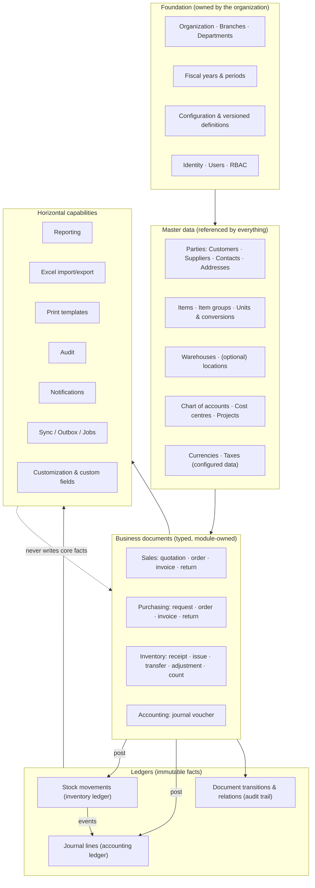
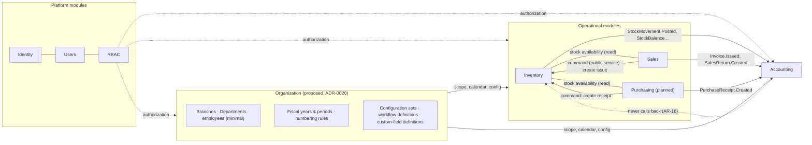
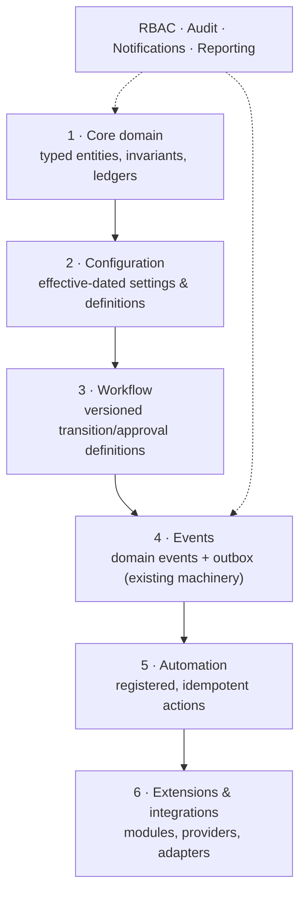

# Vardena — Domain & Configurability Blueprint

Status: Proposed (design for review — no implementation authorized by this document)
Updated: 2026-09-11
Scope: business domain, core model boundaries, configurability architecture.
Companion docs: [index](./README.md) · [glossary](./domain-glossary.md) ·
[decisions](./domain-decisions.md) · [`../../architecture.md`](../../architecture.md) ·
[`../../modules.md`](../../modules.md) · [`../../open-questions.md`](../../open-questions.md)

> **Nothing in this document is a business rule.** Numbering, tax, ledger behaviour,
> approval chains, valuation and retention are either _configuration_ or _expert
> decisions_; where Vardena must choose, this document states options, a
> recommendation, and what would make it wrong. Registered ids: OQ-22 … OQ-35.

---

## 1. Purpose, Method and Constraints

**Purpose.** Vardena must serve substantially different businesses — different
document flows, approvals, warehouse and accounting practices — **without a code
change per customer**, while remaining a normal, queryable, testable ERP. This
blueprint fixes the domain vocabulary and the boundary between _stable core_,
_configuration_, _extension points_ and _expert decisions_, before the first ERP
tables exist.

**Method.**

1. Inspected the repository's normative sources: `.vardena/*`, `docs/architecture.md`,
   `docs/modules.md`, `docs/security.md`, `docs/database-strategy.md`,
   `docs/reporting-strategy.md`, `docs/integrations.md`, `docs/adr/0001–0016`,
   `docs/open-questions.md`, and the implemented `backend/prisma/schema/*`
   (identity/users/rbac) plus the module code.
2. Derived concepts bottom-up from the **business problems** an ERP solves
   (obligations, movements of value, custody of goods, accountability), not from
   another ERP's table list.
3. Classified every concept as Core / Configurable / Extensible / Expert-gated.
4. Rejected designs that trade long-term reportability for short-term flexibility.

**Legacy ERP (FaraPayam) note.** The repository contains no legacy schema or
service contract (only the adapter-isolation decision, ADR-0003, and OQ-04 for the
integration itself). What Vardena extracts from the legacy system is the _problem
class_: Iranian business documents, tax/report formats, batch operations and
on-premise operational reality. Its internal structure **must not** be copied —
Vardena owns its model (`.vardena/project-context.md`).

**Hard constraints inherited.**

- Modular monolith, module boundaries are law, one schema per module (AR-01/07/08/09).
- Backend authorization on every endpoint (AR-21/22); auditing is event-driven (AR-23).
- Inventory ⇢ Accounting is event-only; accounting mapping belongs to Accounting
  (AR-16, ADR-0005). External side effects go through the outbox (AR-14).
- Immutability for journals, movements and audit (AR-13); corrections are
  counter-records.
- Reporting must stay SQL-friendly (ADR-0009).
- No invented business rules (AR-31).

**On "flexibility".** The product requirement is **Controlled Business
Flexibility**: configuration may change _which of the code-defined behaviours_ is
active, _which permissions_ are required, _which documents_ a process creates and
_when_, but it may never change the meaning of a recorded fact. The mechanism is
described in [`configurability-architecture.md`](./configurability-architecture.md).

---

## 2. Core Domain Map



Read the map as dependency direction: **foundation → master data → documents →
ledgers → horizontal capabilities**. Horizontal capabilities read and report; they
never own business facts (AR-06/08).

**Module / domain interaction map** (which module owns which domain concept, and
how the concepts talk). This is the operational view of the same picture:



Two rules visible here are non-negotiable: **side effects are events**, and
**commands (Sales → Inventory) are explicit public-service calls** with the caller
supplying the business intent, while the _effects_ (movements, journals) are owned
by the receiving module.

---

## 3. Core Concepts — the stable spine

These concepts exist in every ERP variant Vardena targets and are therefore
**core**: their tables, identity and relationships may be extended, never
redefined per customer.

| #   | Concept                                                           | Why it is core                                                                                                                                  | Lives in                                                                                           |
| --- | ----------------------------------------------------------------- | ----------------------------------------------------------------------------------------------------------------------------------------------- | -------------------------------------------------------------------------------------------------- |
| C1  | **Organization scope + fiscal calendar**                          | Every fact has an owner, a date and a period; statutory reporting depends on it                                                                 | Organization (proposed)                                                                            |
| C2  | **Party (customer/supplier/contact/address)**                     | Obligations exist toward someone; receivable/payable reporting needs one identity per counterparty                                              | Master data; owned by Sales / Purchasing / Organization (decision in `master-data-strategy.md` §4) |
| C3  | **Item + unit + capability flags**                                | What moves, sells or is serviced; capabilities (stockable, sellable, purchasable, valued, tracked) drive behaviour without type-specific tables | Inventory (master data)                                                                            |
| C4  | **Warehouse (+ optional location)**                               | Custody of physical stock is per location; stock reports are meaningless without it                                                             | Inventory                                                                                          |
| C5  | **Typed business document (header + lines)**                      | Every economic action is recorded as a numbered, auditable, transitionable document                                                             | Owned per module                                                                                   |
| C6  | **Document relation + transition history**                        | Traceability (which order produced which invoice/issue) and partial fulfilment are unavoidable in real businesses                               | Shared mechanism, module-owned usage                                                               |
| C7  | **Stock movement (immutable)**                                    | The only defensible source of truth for stock quantity and its value over time                                                                  | Inventory                                                                                          |
| C8  | **Journal entry (immutable, balanced)**                           | Accounting's facts; every financial report derives from it                                                                                      | Accounting                                                                                         |
| C9  | **Accounting dimensions (account, cost centre, project, branch)** | Reporting by dimension is a baseline ERP expectation                                                                                            | Accounting (+ Organization scope)                                                                  |
| C10 | **Money/quantity semantics**                                      | `numeric(18,2)` money, `numeric(18,4)` quantities, explicit currency column, one quantity base unit                                             | All modules (AR-12)                                                                                |
| C11 | **Audit spine**                                                   | Who did what, when, on which document, with which correlation id                                                                                | Events (AR-23) + module transition tables                                                          |
| C12 | **Configuration as versioned data**                               | Variation between businesses must be data, but historical documents must not be reinterpreted                                                   | Organization (proposed)                                                                            |

Anything not on this list (approval chains, reservations, lot tracking, multi-currency,
inter-branch invoicing, custom fields) is **configuration or extension**, not spine.

---

## 4. Classification Matrix — Core / Configurable / Extensible / Expert

Read each row as: _what must never vary_ (Core), _what a business may change through
configuration_ (Configurable), _what can be added without touching existing code_
(Extensible), _what needs a domain expert before it is decided_ (Expert).

| Capability                                             | Core                                                                                   | Configurable                                                                                                                           | Extensible                                                                | Expert validation                                                                   |
| ------------------------------------------------------ | -------------------------------------------------------------------------------------- | -------------------------------------------------------------------------------------------------------------------------------------- | ------------------------------------------------------------------------- | ----------------------------------------------------------------------------------- |
| **Organization structure**                             | One organization per deployment; branch is a reporting/scope dimension (OQ-01)         | Which branches/departments exist; whether warehouses/locations are enabled; department tree                                            | Business-unit grouping; second legal entity (multi-company)               | Whether branches need separate books/registers (OQ-22)                              |
| **Fiscal calendar**                                    | Fiscal year & periods exist; posting is period-bounded; periods can close              | Start date, period count/length, open/close workflow, who may reopen                                                                   | Multi-year calendars, 13-period calendars                                 | Period definition and closing rules _(expert, OQ-23)_                               |
| **Item / product**                                     | One Item record + kind + capability flags + base unit                                  | Which kinds/groups exist; which capabilities are allowed; required fields per group; lot/serial/expiry on/off                          | New _capabilities_ (code change), kit/BOM, variants — later modules       | Whether services/contracts need revenue recognition treatment _(expert)_            |
| **Units & conversions**                                | Quantities stored in one base unit; conversions are explicit data                      | Allowed units, their precision, global and item-specific conversions                                                                   | Alternative packaging, catch-weight items                                 | Fractional-unit rounding & presentation rules _(expert, OQ-29)_                     |
| **Warehouses & locations**                             | Stock is always per warehouse; movements immutable                                     | Locations on/off, per-warehouse defaults, negative-stock policy                                                                        | Automated/robotic location addressing                                     | Whether negative stock is legally/semantically allowed _(expert, OQ-24)_            |
| **Document flows** (`quote → order → invoice → issue`) | Document types and their allowed transitions are code-defined; posting is irreversible | _Which_ flow a business uses: which documents are required, which transitions auto-create which follow-up document, which are optional | New document types (new module/session), new relation kinds (code change) | Legal/statutory documents and their required sequence _(expert, OQ-27)_             |
| **Approvals**                                          | A transition may require approval; the decision is recorded with actor + time          | Thresholds, which transitions need approval, who approves (permission code), single vs multi-level                                     | Delegation, escalation, parallel approval _(later, OQ-26)_                | Segregation-of-duties expectations for finance roles _(expert, OQ-26)_              |
| **Statuses**                                           | Status set per document type is fixed in code (`draft/approved/posted/cancelled/…`)    | Which transitions are enabled; labels/translations; whether approval is needed between states                                          | Additional states require a code change + ADR                             | Whether a status has legal meaning (e.g. "issued" invoice) _(expert)_               |
| **Numbering**                                          | Numbers are unique per configured scope; assigned inside the write transaction         | Prefix, scope (org/branch/warehouse/type), padding, reset period                                                                       | Multiple series per type (per branch/warehouse)                           | Legal gap/year rules and required formats _(expert, OQ-12)_                         |
| **Taxes**                                              | Tax is computed per line and stored explicitly on the document                         | Rates, tax groups, inclusive/exclusive behaviour, exempt categories                                                                    | New tax types (withholding, excise) via code                              | All of it: rates, liability accounts, e-invoice fields _(expert, OQ-30)_            |
| **Chart of accounts**                                  | Accounts exist, are hierarchical, and are referenced by journal lines                  | Which accounts, codes, levels and mappings a business uses                                                                             | Industry templates; sub-ledger modules; consolidation                     | Coding scheme, statutory formats, control accounts _(expert, OQ-25)_                |
| **Posting rules (event → journal)**                    | Mapping is owned by Accounting; posting is idempotent per event                        | Per-organization account mapping (which account, which dimension defaults)                                                             | New mapping templates per event type                                      | Which account, which side, when revenue/cost is recognized _(expert)_               |
| **Costing / valuation**                                | Movements carry quantity and (when known) unit cost; balances are derivable            | The **method** is a per-organization setting (moving average / FIFO / standard)                                                        | Cost layers, revaluation runs                                             | The method itself, its effects on COGS/margin and inventory value _(expert, OQ-24)_ |
| **Period close & year-end**                            | Closing produces an auditable state; posting into closed periods is rejected           | Close checklist, lock granularity                                                                                                      | Retained-earnings automation, opening-balance import tooling              | Closing/opening entries, profit appropriation _(expert, OQ-23)_                     |
| **Currencies**                                         | Amounts store their currency; base currency per organization                           | Whether foreign currency is used at all; rate source & frequency                                                                       | Multi-currency ledgers, revaluation                                       | IRR/RMT legality, precision, exchange-difference accounts _(expert, OQ-03)_         |
| **Permissions & roles**                                | Code-registered granular permissions; backend enforcement (ADR-0006/0016)              | Which roles exist and which codes they hold; seed role sets                                                                            | Module-provided permission namespaces                                     | Auditor separation-of-duties expectations (OQ-14)                                   |
| **Required/optional fields**                           | Base contract fields (item, quantity, date, type)                                      | Per-document-type required/optional _among code-supported_ fields                                                                      | New fields via a code change with an ADR if financial                     | Which fields are legally required on invoices _(expert)_                            |
| **Notifications**                                      | Events exist; notification rules are registered by modules                             | Which events notify which roles/users, channels (in-app first)                                                                         | Email/SMS channels (OQ-15)                                                | Nothing legal in v1                                                                 |
| **Reporting**                                          | Definitions are code-owned; data comes from module views (ADR-0009)                    | Saved filters, dashboards, column layouts (per user)                                                                                   | New report definitions, new module views                                  | Statutory report formats _(expert)_                                                 |
| **Custom fields**                                      | Financial/inventory dimensions and amounts are **never** custom fields                 | Whitelisted descriptive fields on a small set of entities; their definitions are configuration                                         | Promotion path: custom field → real column + migration                    | Anything that must appear in statutory reports _(expert)_                           |
| **Integrations**                                       | Outbox + adapter ports (ADR-0003/0004)                                                 | Which destinations are enabled, credentials, retry policy                                                                              | New adapters; new outbound operations                                     | Tax-system payload/legal requirements _(expert, OQ-05/OQ-30)_                       |

**How to read "Configurable" here:** configuration changes _selection and
parameters_, never semantics. A business can choose to require an order before an
invoice; it cannot configure "an invoice counts as stock movement" — that would
change what the recorded facts mean.

---

## 5. Item / Product Domain — recommendation

Full analysis in [`master-data-strategy.md`](./master-data-strategy.md) §2–§3.
Summary of the recommendation:

- **One `Item` table** for goods, services, consumables, assets, raw materials and
  semi/finished goods. No per-type tables, no `ItemAttributeValue` EAV.
- **Closed `item_kind`** (code-managed list) selects _defaults_; **explicit
  capability flags** on the item are the truth the code branches on:
  `is_stockable`, `is_purchasable`, `is_sellable`, `is_valued`, `requires_lot`,
  `requires_serial`, `requires_expiry`.
  - `service`: `is_stockable = false`, `is_valued = false`, `is_sellable = true`
    (typical), no warehouse dimension on its document lines.
  - `goods`/`raw_material`/`finished_good`/`semi_finished`: stockable; valuation
    and tracking capabilities configurable.
  - `consumable`: typically stocked but not sold.
  - `asset`: purchasable, tracked, but **not** part of stock turnover; asset
    management is a later module (flagged as a domain decision, `domain-decisions.md` D-25).
- **Why flags instead of type-based branching:** reporting, permissions and document
  validation all need to ask "is this item sellable/stockable?" without a
  `switch (type)`. Flags keep the question relational and indexable, and let a
  business make one exception (e.g. a service that _is_ stocked as a spare part)
  without a schema change.
- **Units:** each item has one base unit; conversions are data (`master-data-strategy.md` §3).
- **Explicitly out of scope in the first ERP slice:** variants/matrix items, kits/BOM,
  substitutes, serialized service contracts. They are extension points, and adding
  them later must not require changing `Item`'s identity (flagged in the gate list).

---

## 6. Business Document Architecture — recommendation

Full analysis in [`document-architecture.md`](./document-architecture.md) §2–§3.

**Option B is recommended: a controlled common document _foundation_ with
specialized, module-owned document tables.**

| Option                                              | What it means                                                                                                                                                      | Verdict                                                                                |
| --------------------------------------------------- | ------------------------------------------------------------------------------------------------------------------------------------------------------------------ | -------------------------------------------------------------------------------------- |
| A. Fully independent models per type                | Every document type reinvents numbering, lines, statuses, relations, validation                                                                                    | Rejected: duplicated rules drift; cross-type reports become unions of unrelated shapes |
| B. Shared foundation + specialized types            | Typed tables per document type; shared _contracts_ (line shape, status/transition mechanics, numbering, relation & transition tables); shared kernel-level helpers | **Recommended**                                                                        |
| C. One universal `documents` table with JSONB lines | Maximum uniformity                                                                                                                                                 | Rejected: destroys type safety, indexing, FK integrity, reporting (see §10)            |

"Shared foundation" is deliberately **not** "one giant table". Concretely it means:

1. Every document type is a real table with typed columns and FKs, in its owning
   module's schema.
2. A small set of **shared mechanics** is reused: `document_links` (typed relations
   with quantities) and `document_transitions` (append-only status history) — see
   ADR-0019. These are _mechanisms_, not a business model.
3. Common header columns follow AR-12 (`id`, audit columns) plus a small, agreed
   document contract: `document_number`, `document_date`, `status`, `branch_id`,
   `currency`, `totals` (see `document-architecture.md` §4).
4. Line tables carry the **dimensions** (item, quantity in base unit, unit, unit
   price, discount, tax, warehouse/location, cost centre, project) as real typed
   columns — because every report groups by them.

---

## 7. Document Relationships

Summary; the model and diagrams are in
[`document-architecture.md`](./document-architecture.md) §5–§6.

- Relations are **typed** (`reference`, `derive`, `fulfill`, `reverse`, `settle`)
  using a **closed, code-managed** relation-kind list — not a free string, not a
  user-defined graph.
- Relations are stored in a shared relation table with **line-level quantity rows**
  so partial conversion is expressible and _remaining quantity is computable in SQL_.
- Allowed relation kinds per document-type pair are part of the code-defined
  document contract; configuration chooses whether a relation is created
  automatically by an automation rule, never whether it is _legal_.
- Realistic patterns, all constructible without hard-coding one process:
  `Quotation → SalesOrder → Invoice → Issue`, `Invoice → Issue`,
  `SalesOrder → Issue → Invoice`, `PurchaseOrder → PurchaseReceipt → PurchaseInvoice`,
  `PurchaseReturn ← PurchaseReceipt`, `StockTransfer → two linked movements`,
  `JournalEntry ↔ source document` (reference only, Accounting-owned).
- Cancellation/reversal: unposted documents are cancelled; posted documents are
  neutralized by a **counter-document** linked with `reverse`, so history keeps both.

---

## 8. Workflow Architecture

Full design in [`workflow-architecture.md`](./workflow-architecture.md) (ADR-0018).

The separation the task asks for maps to six distinct constructs, and they must not
be collapsed into one table:

```
Status        code-defined per document type      (data: where the document is)
Transition    code-defined allowed edges          (audit: how it got there)
Permission    RBAC code required for an edge      (authorization, ADR-0006/0016)
Approval      recorded decision that an edge may  (segregation of duties, auditable)
              proceed (threshold/role conditions)
Business rule declarative condition on fields     (bounded expressions, no scripting)
Automation    event-driven, idempotent effects    (creates documents/movements/journals)
```

Key decisions:

- **Statuses and transitions are code** (a closed set per document type, so reports,
  permissions and validation are compile-time safe). **Configuration selects which
  transitions are enabled, who may perform them, whether approval is required and
  which automation fires** — it cannot invent states.
- **Workflow definitions are versioned and effective-dated**; every document stores
  the workflow version it was created under (ADR-0018). Changing tomorrow's process
  never rewrites yesterday's document.
- **No scripting, no expression language beyond a bounded condition set** (numeric
  comparison on document totals/lines, date, partner/warehouse attributes, permission
  and organizational scope). Conditions are evaluated in code against typed fields.
- **Automation is event-driven and idempotent**, using the existing event/outbox
  machinery (AR-14/15): "on `Invoice.Issued`, create the linked inventory issue" is a
  registered action, not a user-defined script.
- Minimum viable workflow (v1 scope): enabled transitions + required permission +
  optional **single-level** approval with thresholds + a closed catalogue of
  automatic follow-up actions. Multi-level/parallel approvals, delegation and
  escalation are extension points (OQ-26).

The point is that Business A (`Quote → Approval → Invoice → Issue → Accounting`),
Business B (`Order → Issue → Invoice`) and Business C (`Invoice → Issue`) differ only
in **configuration rows** over the same code-defined document and transition sets.

---

## 9. Accounting Domain

Full analysis in [`accounting-domain-analysis.md`](./accounting-domain-analysis.md).
**Every accounting recommendation in this blueprint is flagged for expert
validation**; the project owner's operational experience is input, not authority.

- Accounting owns accounts, journals, periods and the **event → journal mapping**
  (AR-16). Inventory never posts; it publishes events.
- **Chart of accounts:** four options compared (fixed system chart; standard
  template + customization; fully organization-defined; hybrid). Recommendation:
  **hybrid — a code-provided template skeleton, organization-editable accounts
  below the control level, with control accounts and their semantics fixed in code.**
  This keeps statutory/report automation possible while matching how Iranian
  businesses actually operate. _(expert, OQ-25)_
- **Fiscal calendar:** fiscal year + periods as configuration with an explicit
  start date; closing is a recorded, auditable act; posting into a closed period is
  rejected (OQ-23, expert).
- **Posting:** documents post to journals through mapping rules; journal entries are
  immutable and balanced; corrections are reversing entries (AR-13, expert).
- **Inventory valuation interacts with accounting through the movement ledger**: the
  ledger carries quantity and cost data; the _method_ (moving average/FIFO/standard)
  is an accounting decision that must not be baked into the inventory schema
  (ADR-0017, OQ-24, expert).
- **Sales/Purchasing effects** (revenue, receivable, COGS, payable, tax) are mapping
  rules over events — never hard-coded in the selling/buying module (AR-16).

---

## 10. Sales and Purchasing Domains

### Sales (`sales`)

- **Documents:** quotation, sales order, invoice, sales return (credit note). Their
  _presence and order_ are configuration (see §8).
- **Customer:** party record with credit/terms attributes; credit-limit enforcement
  is not yet specified _(OQ — flagged in `domain-decisions.md` D-14)_.
- **Pricing/discounts:** pricing rules are configuration-or-code decisions; v1
  recommendation is **explicit line prices with optional configured price lists**
  (code-supported, organization-configured data), because ad-hoc price engines are a
  classic unbounded feature (D-13).
- **Stock effect:** Sales **does not touch stock**. It either (a) requests an issue
  from Inventory through a public command, or (b) publishes `Invoice.Issued` and an
  automation/configuration decides whether an issue is created. Both paths are
  supported without hard-coding `Invoice → Issue` as the only process.
- **Accounting effect:** events only; Accounting maps them.

### Purchasing (`purchasing`, planned — OQ-16)

- **Documents:** purchase request, purchase order, purchase invoice, purchase return,
  goods receipt (or receipt created directly in Inventory).
- **Shared with Sales:** the same document foundation, the same relation model, the
  same approval semantics, the same party/contact/address master data shape.
- **Specialized:** goods receipt semantics (inspection, rejected quantity, landed
  cost allocation), supplier price lists, three-way matching (PO ↔ receipt ↔ invoice)
  — planned as an explicit module feature, not as a generic engine.
- **Stock & accounting effects:** receipt → inventory movement (Inventory owns it);
  invoice → payable/journal (Accounting owns it). Purchasing never writes those tables.

---

## 11. Organizational Flexibility

Full analysis and alternatives: [`master-data-strategy.md`](./master-data-strategy.md) §2,
ADR-0020 (Proposed), OQ-22.

**Recommended model (v1):**

- **One organization per deployment** (OQ-01 assumption): the organization is the
  configuration root (calendar, CoA, numbering, workflow versions).
- **Branch** is an explicit, first-class **scope column** (`branch_id`) on documents,
  warehouses, numbering scopes, journals and stock balances; a branch is not a
  separate ledger.
- **Department** is organizational master data used for responsibility reporting;
  whether it doubles as an accounting dimension is expert-gated.
- **Master-data scope (recommendation):** shared by default, branch-scoped only where
  the business genuinely differs:
  - Organization-scoped: units, currencies, taxes, chart of accounts, item groups,
    items, partners, cost centres, projects.
  - Branch-scoped: warehouses (a warehouse belongs to exactly one branch), numbering
    series, document templates/letterheads, cash/bank accounts.
- **Multi-company (two legal entities in one database)** is explicitly _not_ designed
  yet: it needs an ADR and a schema-wide decision, not a nullable `company_id` added
  later as an afterthought. Two legal entities today = two deployments, with a
  future consolidation/export path.

---

## 12. Master-Data Lifecycle & Historical Integrity

Rules that must hold for every master-data table (details in
[`master-data-strategy.md`](./master-data-strategy.md) §7):

| Stage              | Rule                                                                                                                                                                                                                                                                     |
| ------------------ | ------------------------------------------------------------------------------------------------------------------------------------------------------------------------------------------------------------------------------------------------------------------------ |
| Create             | Business key unique among **non-deleted** rows (partial unique index). Capability/scope defaults resolved at creation, then owned by the row.                                                                                                                            |
| Edit               | Allowed; changes are audited (`updated_at/by`, domain event, before/after for sensitive fields).                                                                                                                                                                         |
| Disable            | A first-class state (`is_active`), reversible, blocks _new_ usage without touching history.                                                                                                                                                                              |
| Archive            | For records that must never be selectable again but must remain readable in reports; implemented as disable + a `archived_at` marker if needed, never as deletion.                                                                                                       |
| Delete             | **Only for never-referenced records.** Where history exists: soft delete (`deleted_at/by`, AR-13) with references preserved. Where the record is a financial dimension (account, cost centre), never delete — disable/archive only. _(expert for accounting dimensions)_ |
| Effective dating   | For configuration that changes behaviour over time (tax rates, mappings, workflow versions, price lists): rows carry `valid_from`/`valid_to`; changes create a new row, they do not overwrite.                                                                           |
| Renaming           | Historical documents keep the id; reports may show the historical or current label — decided per report, but **never** by rewriting history.                                                                                                                             |
| Reporting identity | Every master record has a stable code (human) and id (machine) so reports can be grouped even after a rename.                                                                                                                                                            |

The invariant: **a historical document must remain fully interpretable without the
current state of any master record.** That is why documents copy the _values_ they
depend on (unit price, tax rate, unit, exchange rate, account mapping version) at
posting/issue time even where an FK also exists.

---

## 13. Reporting Implications

Every decision above was checked against reportability (ADR-0009). The rules that
keep common ERP reports possible:

| Decision                                                                                                                     | Reporting consequence                                                                                                                     |
| ---------------------------------------------------------------------------------------------------------------------------- | ----------------------------------------------------------------------------------------------------------------------------------------- |
| Movement ledger + materialized balances (ADR-0017)                                                                           | Stock-on-hand is a single indexed read; stock-card/movement reports scan the immutable ledger; balances can be rebuilt for reconciliation |
| Typed document tables (not JSONB lines)                                                                                      | Sales/purchase registers are plain SQL over typed columns; no JSON extraction in reports                                                  |
| Dimensions as real columns on document/ledger lines (item, warehouse, branch, cost centre, project, partner, date, currency) | Every report filters/groups by indexed columns; no joins through EAV tables                                                               |
| Status stored explicitly per document (+ transition history)                                                                 | "Open orders", "unposted invoices", "cancelled documents" are simple predicates; audit reports can replay transitions                     |
| Document relations with line quantities                                                                                      | "Ordered vs delivered vs invoiced" and remaining-quantity reports are computable in SQL                                                   |
| Accounting mapping version captured per posting                                                                              | Historical margins/COGS reports remain stable when mappings change                                                                        |
| Configuration effective dating                                                                                               | Point-in-time reports (tax rate at invoice date, workflow version) are reproducible                                                       |
| Custom fields restricted to descriptive JSONB                                                                                | Custom data never becomes a reporting dimension; if it must be reported on, it is promoted to a real column (documented migration path)   |
| Module-owned views (`vw_*`) for cross-module reporting                                                                       | Reporting stays view-first and parameterized (ADR-0009); no ad-hoc joins across module tables from other modules' code                    |

**Rejected for reporting reasons:** dynamic per-organization tables/columns, EAV
attributes on documents, JSONB line items, and any "report builder" that assumes the
schema is generic.

---

## 14. Configuration Versioning & Historical Integrity

Summary; the mechanism is specified in
[`configurability-architecture.md`](./configurability-architecture.md) §4 (ADR-0018).

Three classes of configuration, each with a different versioning rule:

1. **Code-defined structure** (document types, status sets, transition edges,
   permission codes, capability flags, report definitions): versioned with the
   application, changed only by code + migration + ADR when semantics change.
2. **Organization configuration data** (numbering series, tax rates, account
   mappings, price lists, templates, custom-field definitions): rows with
   `valid_from`/`valid_to` where the change affects historical interpretation;
   superseding rows, never in-place rewrites.
3. **Workflow definitions**: explicitly versioned (`workflow_definition_versions`)
   with draft/published states; documents pin the version they used.

**The rule that protects history:** a document, movement or journal records the
_values_ and the _configuration version_ it used. Changing configuration affects
future documents only; in-flight documents either stay on their pinned version or are
explicitly migrated through an audited action (never silently).

---

## 15. Business Rule Categories

Full discussion in [`configurability-architecture.md`](./configurability-architecture.md) §6.

| Category                       | Examples                                                                                      | Where it lives                                                                    | Changeable by configuration?                             |
| ------------------------------ | --------------------------------------------------------------------------------------------- | --------------------------------------------------------------------------------- | -------------------------------------------------------- |
| **Domain invariants**          | Balanced journal entry; posted document immutable; quantity > 0 on a movement; debit = credit | Code + database constraints                                                       | **No** — this is the meaning of the facts                |
| **Organization configuration** | Fiscal start, numbering format, negative-stock policy, default warehouse per branch           | Configuration tables                                                              | Yes                                                      |
| **Workflow rules**             | Which transition is enabled, who may perform it, approval thresholds                          | Workflow definition versions                                                      | Yes (within code-defined edges)                          |
| **Validation rules**           | Required fields, value ranges, partner/item capability constraints                            | DTO/domain validation + configuration for _which optional_ fields become required | Partly (required-ness only)                              |
| **Automation rules**           | "On invoice issued, create issue"; "notify finance on credit-limit breach"                    | Registered actions + declarative triggers                                         | Yes (within the registered action catalogue)             |
| **Accounting rules**           | Which accounts, which side, recognition timing, valuation method                              | Accounting mapping data (+ expert-approved code)                                  | Organization mapping: yes; method/rules: expert decision |
| **Integration rules**          | Destination enabled, retry policy, payload version                                            | Integration configuration                                                         | Yes                                                      |

**No universal rules engine.** A general expression/scripting engine is rejected
(§10/§17): the rule categories above are implemented in code with narrow, typed
configuration surfaces. Each new configurable rule must be _designed_ (fields it may
read, actions it may trigger) before it is exposed.

---

## 16. Flexibility Architecture (recommended stack)



Evaluate alternatives to this stack:

| Alternative                                                      | Why not                                                                              |
| ---------------------------------------------------------------- | ------------------------------------------------------------------------------------ |
| Configuration _inside_ the core (flags scattered on core tables) | Core tables become unreadable; no history; every new variation adds columns          |
| Everything driven by events with no configuration layer          | Automation without a declared, reviewable definition is not auditable or predictable |
| A universal workflow/rules engine above the core                 | Unbounded scope; un-reviewable logic; kills type safety and reporting (§17)          |
| Per-customer code branches or database forks                     | Maintenance impossibility, security-patch fragmentation                              |
| EAV/JSONB core                                                   | Kills integrity, indexes and reporting                                               |

The recommended stack is deliberately shallow: **six layers, each with a narrow
purpose**, and the existing platform (events, outbox, RBAC, audit, reporting) is
reused rather than duplicated.

---

## 17. Anti-Patterns — explicit evaluation

| Anti-pattern                                                                     | Verdict               | Why / what we do instead                                                                                                                                                                                |
| -------------------------------------------------------------------------------- | --------------------- | ------------------------------------------------------------------------------------------------------------------------------------------------------------------------------------------------------- |
| Giant EAV (Entity→Attribute→Value) for the whole system                          | **Rejected**          | No type safety, no constraints, catastrophic query plans, reports become pivots. Custom attributes are limited to a whitelisted JSONB column on a few entities (§ `configurability-architecture.md` §5) |
| Everything JSONB                                                                 | **Rejected**          | Financial/inventory dimensions, quantities, dates and statuses must be typed columns for constraints, indexes and reporting (ADR-0009)                                                                  |
| Giant universal `Document` table                                                 | **Rejected**          | One table cannot express per-type validation, FKs and report shapes; every module would depend on every other module's fields. Typed tables + shared _mechanics_ (ADR-0019)                             |
| Giant universal workflow engine                                                  | **Rejected**          | Turns the ERP into a low-code platform: unreviewable, untestable, unbounded. Bounded transitions + configuration + registered automations (ADR-0018)                                                    |
| Business logic in DB triggers                                                    | **Rejected**          | Hidden coupling, untestable, bypasses authorization/audit, migration-hostile. Constraints stay in the DB, decisions stay in the application (AR-03/04)                                                  |
| Business logic in the frontend                                                   | **Rejected**          | Frontend is untrusted (AR-19/21); it renders and requests, it never decides                                                                                                                             |
| Hard-coded workflow per customer                                                 | **Rejected**          | Defeats the product goal; workflow is configuration over code-defined edges                                                                                                                             |
| One table (or schema) per customer/business                                      | **Rejected**          | Unmaintainable, breaks migrations and reporting; variation belongs in rows, not in DDL                                                                                                                  |
| Customer-specific code forks                                                     | **Rejected**          | Security/compliance and upgrade cost. Customer variation = configuration + extension points, or a plugin module                                                                                         |
| Excessive inheritance/abstraction (deep class hierarchies, generic repositories) | **Rejected**          | Indirection without value; explicit code per module wins (matches the existing codebase style)                                                                                                          |
| Microservices too early                                                          | **Rejected**          | ADR-0001: one deployable on-premise; boundaries are preserved _inside_ the monolith so extraction stays possible                                                                                        |
| Multi-tenancy by default                                                         | **Deferred**          | OQ-01 assumes one organization per deployment; adding tenancy later is an ADR + migration, not a nullable column sprinkled everywhere                                                                   |
| Universal custom-field engine on every table                                     | **Deferred/rejected** | Only where § `configurability-architecture.md` §5 allows; everything financial stays relational                                                                                                         |

---

## 18. Risks Register

| #   | Risk                                                               | Impact                                   | Mitigation                                                                                     | Owner                        |
| --- | ------------------------------------------------------------------ | ---------------------------------------- | ---------------------------------------------------------------------------------------------- | ---------------------------- |
| R1  | Accounting decisions made by non-experts                           | Wrong books, legal exposure              | Every accounting item is expert-gated (OQ-23/24/25/30); no posting logic before sign-off       | Project owner + accountant   |
| R2  | Workflow model over-built early (engine instead of bounded config) | Schedule and maintenance sink            | MVW scope in ADR-0018; extension points for multi-level approval                               | Architecture                 |
| R3  | Configuration drift between environments (dev/staging/prod)        | "Works on my machine" for business flows | Configuration export/import + versioned seeds (deployment tooling, flagged)                    | Ops + architecture           |
| R4  | Custom fields used for business-critical data                      | Data loss/duplication; reporting holes   | Registry + whitelist + promotion path; review gate before enabling                             | Architecture                 |
| R5  | Reporting performance degrades as configuration grows              | Slow reports, user distrust              | Typed columns, indexed dimensions, materialized balances, view-first reporting (ADR-0009/0017) | Architecture                 |
| R6  | Historical documents reinterpreted after config change             | Audit/legal invalidation                 | Effective dating + pinning per document (§14)                                                  | Architecture + auditor       |
| R7  | Master-data deletion used as "cleanup"                             | Broken history                           | Lifecycle rules (§12) + permission separation (`*.Delete` rarely granted) + soft delete        | Architecture                 |
| R8  | Unit conversion/rounding errors                                    | Quantity discrepancies                   | Base-unit storage, explicit conversions, precision config, expert sign-off (OQ-29)             | Inventory expert             |
| R9  | Branches silently acting as separate companies                     | Wrong consolidation/reporting            | Branch ≠ legal entity is explicit; multi-company is a separate ADR (OQ-22)                     | Project owner + accountant   |
| R10 | Legacy ERP data imported with its structure                        | Model corruption                         | Import via module ImportSpecs (ADR-0011) after mapping decisions; never copy legacy tables     | Project owner + architecture |

---

## 19. Requires Domain-Expert Validation

Nothing in this list may be implemented from this document alone. Each item names the
expert and the artefact that must be signed off.

| Area                           | Decision needing validation                                                              | Expert                                 | Reference                          |
| ------------------------------ | ---------------------------------------------------------------------------------------- | -------------------------------------- | ---------------------------------- |
| Chart of accounts              | Structure, coding scheme, control accounts, statutory reporting levels                   | Accountant                             | OQ-25                              |
| Fiscal calendar                | Year start, period layout, close/reopen rules, year-end entries                          | Accountant                             | OQ-23                              |
| Posting rules                  | Event → account mapping, recognition timing, dimensions required per entry               | Accountant                             | `accounting-domain-analysis.md` §4 |
| Inventory valuation & costing  | Method (moving average/FIFO/standard), COGS, revaluation, negative stock                 | Accountant + inventory expert          | OQ-24                              |
| Tax                            | Rates/groups, inclusive/exclusive, exemptions, liability accounts                        | Tax expert                             | OQ-30                              |
| E-invoicing / taxpayer system  | Required fields, formats, submission flow, retention                                     | Tax expert + integration owner         | OQ-05                              |
| Legal documents                | Which documents are statutory, required sequences, number formats/gaps, retention window | Accountant + legal                     | OQ-12/OQ-27                        |
| Unit & quantity precision      | Fractional units, rounding/presentation rules                                            | Inventory expert + accountant          | OQ-29                              |
| Inter-branch/inter-company     | Whether internal transfers need invoicing/settlement; transfer pricing                   | Accountant                             | OQ-31                              |
| HR/payroll scope               | Whether employees/payroll are part of Vardena at all                                     | Project owner (+ HR/legal later)       | OQ-32                              |
| Approval/segregation of duties | Which financial actions need independent approval; auditor expectations                  | Accountant + ERP implementation expert | OQ-26                              |

---

## 20. Final Review

**1. Can Vardena support substantially different business workflows without
source-code changes?**
Yes, within a bounded space: document _types_ and their legal transitions are
code-defined, and each business configures which transitions are enabled, who may
perform them, which need approval with what thresholds, and which registered
automations fire (ADR-0018). Business A (`Quote → Approval → Invoice → Issue`),
Business B (`Order → Issue → Invoice`) and Business C (`Invoice → Issue`) are three
configuration versions over the same code. A genuinely new _kind_ of step (a state
that does not exist in code) is a code change — deliberately.

**2. Which parts are configurable?**
Organization structure and scope, fiscal calendar, units/conversions, warehouse
locations, negative-stock policy, document-flow selection, approvals and thresholds,
numbering formats, taxes and rates, chart-of-accounts content, posting mappings,
costing method, currencies, roles/permissions, required/optional fields among
code-supported fields, notifications, saved reports/dashboards, and whitelisted
custom fields (§4 matrix).

**3. Which parts must remain stable core domain concepts?**
The spine: organization scope + fiscal calendar, party, item + capability flags,
warehouse, typed document with lines, document relations/transitions, immutable stock
movements, immutable balanced journals, accounting dimensions, money/quantity
semantics, audit spine, and versioned configuration. These cannot be redefined per
customer without an ADR and a migration.

**4. How can workflows evolve without corrupting historical documents?**
Workflow definitions are versioned with draft/published states; every document pins
the version it was created under; transitions are recorded append-only with actor,
time and version. A new version applies to new documents; in-flight documents either
stay pinned or are explicitly migrated by an audited action. Effective dating does the
same job for tax rates, mappings and price lists.

**5. How can document relationships remain flexible without becoming an uncontrolled
generic engine?**
Relation _kinds_ are a closed, code-managed list; a shared relation table stores
typed links with **line-level quantities** so partial fulfilment is expressible; each
document type declares which relations are legal. Configuration decides _when_ a
relation is created automatically, not _whether the relation type exists_.

**6. How can inventory remain reliable and reportable?**
Movements are the immutable source of truth; balances are materialized in the same
transaction and rebuildable from the ledger; dimensions (item, warehouse, location,
lot/serial, branch, date) are typed columns; valuation method is a configuration that
consumes the ledger rather than shaping it. Reconciliation (ledger vs balance vs
accounting inventory account) is a routine, not an emergency.

**7. How can accounting remain correct while still allowing organizational
flexibility?**
Accounting owns the accounts, the calendar, the periods and the event→journal
mappings; journals are immutable and balanced; branches are dimensions, not separate
books; the chart of accounts is a code-provided template with organization-editable
accounts below fixed control-account semantics. Every accounting rule is validated by
an accountant before implementation, including the valuation method that inventory
must feed.

**8. How can custom fields be supported without turning the ERP into EAV/JSONB?**
By restricting them: a registry of definitions, a whitelist of entities (partners,
items, and selected document headers — not ledger lines, not amounts/dimensions), a
single `custom_fields jsonb` column with GIN only where a real query exists, typed
validation on write, and an explicit promotion path (custom field → real column +
migration) when a field turns out to matter for reporting or legality.

**9. What decisions are still unsafe to make without a domain expert?**
Chart of accounts content/structure, fiscal calendar and closing rules, posting
mappings and recognition timing, valuation/costing method, tax treatment and rates,
e-invoice/legal document requirements and retention, fractional-unit rounding,
inter-branch/inter-company settlement, and HR/payroll scope. See §19.

**10. What should be frozen before the first major ERP Prisma migration?**
The list below — "Gate Before Core ERP Schema".

---

## 21. Gate Before Core ERP Schema

No ERP business table (item, warehouse, partner, document, movement, journal) may be
migrated before these are resolved and recorded (resolved = decided in an ADR, an
answer in `docs/open-questions.md`, or an explicit, dated owner decision):

**Blocking — must be decided first**

1. **Organization model**: one organization per deployment confirmed; branch
   semantics agreed (branch ≠ legal entity); master-data scope per entity
   (organization-wide vs branch-scoped). → OQ-22, ADR-0020 (accept/reject).
2. **Inventory source of truth**: accept ADR-0017 (immutable movement ledger +
   materialized balances), and decide **negative-stock policy** and **location
   granularity** defaults. → OQ-24.
3. **Costing/valuation method** (at least: which method is _possible_ in v1) →
   OQ-24, accountant sign-off. Without it the movement/valuation columns cannot be
   finalized (cost columns may be present, but their semantics must be agreed).
4. **Item model**: one Item + kind + capability flags and the closed kind list →
   OQ-33; unit/conversion semantics including precision and rounding → OQ-29.
5. **Document foundation & relations**: accept ADR-0019 (typed tables + shared
   link/transition mechanics); confirm relation-kind vocabulary and the
   partial-quantity model.
6. **Workflow MVW scope**: accept ADR-0018 (bounded, versioned definitions; no
   engine); decide whether v1 includes approvals at all or only transitions.
7. **Fiscal calendar & period model**: year start, period layout, close/reopen rule
   → OQ-23, accountant sign-off.
8. **Chart of accounts approach** (hybrid recommendation) and **account code scheme**
   → OQ-25, accountant sign-off.
9. **Document numbering rules**: format, scope, gap policy, reset behaviour → OQ-12
   (existing), accountant/legal sign-off.
10. **Money & currency semantics**: base currency, precision, whether foreign
    currency exists in v1 → OQ-03.
11. **Tax data model**: tax groups/rates as configuration, inclusive/exclusive,
    rounding per line vs per document → OQ-30, tax sign-off.
12. **Custom-field policy**: confirm "none in the first migration for financial
    documents" and the whitelist → `configurability-architecture.md` §5, OQ-28.
13. **Effective-dating/versioning conventions**: which tables carry
    `valid_from/valid_to` and how versions are pinned → ADR-0018, §14.

**Non-blocking but must be registered before the first migration is reviewed**

- Approval/delegation expectations (OQ-26), legal immutability window and amendment
  policy (OQ-27), inter-branch/internal settlement (OQ-31), HR/payroll scope (OQ-32),
  audit/log retention (OQ-17), reporting formats (statutory) and saved-report
  behaviour (OQ-10), notification channels (OQ-15).

**First migration candidate (after the gate).** The smallest coherent slice that
unblocks everything else without committing to financial semantics:

1. Organization module: branches, departments, employees (minimal), fiscal years &
   periods, configuration settings storage (+ `organization` schema).
2. Master data: units + conversions, item groups, items with capability flags,
   warehouses (+ optional locations).
3. Shared document mechanics: document numbering series and the transition/relation
   tables, exercised by **one** document type in a later, separate migration.

Inventory movements, journals and financial document tables are **released only after
items 2, 3, 4, 5, 7, 8, 9, 10, 11 above are decided** — they encode the accounting
semantics that must not be guessed.
