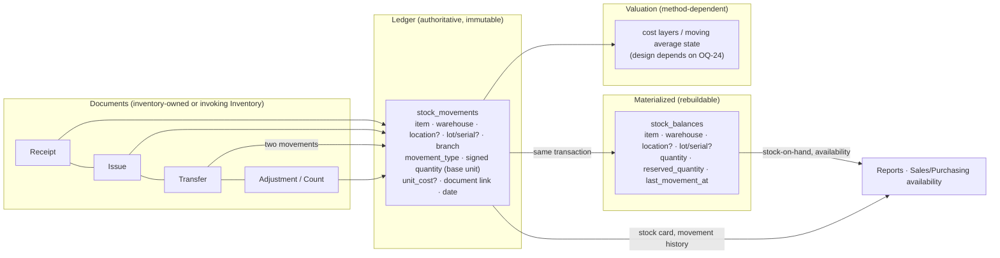

# Inventory Domain Analysis

Status: Proposed (design for review) · Updated: 2026-09-11
Companion: [blueprint](./domain-blueprint.md) §5/§9 · [master data](./master-data-strategy.md) ·
ADR-0017 (proposed) · ADR-0005/0016 · AR-13/16 · OQ-24, OQ-29, OQ-31

Inventory answers one question with certainty: **how much of what is where, and what
did it cost**. This analysis decides where the truth lives, how balances stay fast,
and which parts are accounting decisions that must not be guessed.

---

## 1. The central question — where is the source of truth?

| Option | Description | Pros | Cons |
|---|---|---|---|
| **A. Balance is authoritative** | One row per (item, warehouse, …) holding `quantity`; movements are optional notes | Fast reads; simple mental model | No history (how did we get here?); corrections are silent edits; audit/legal failure; cannot value FIFO or explain differences; concurrent updates need careful locking with no compensating ledger |
| **B. Movement ledger is authoritative** | Every change appends an immutable movement; balances computed by `SUM` on demand | Complete history, auditable, correctable by counter-movements, natural valuation input | Naive `SUM` over millions of rows is slow for "stock on hand" screens and availability checks; every read pattern must be indexed carefully |
| **C. Movement ledger **+** materialized balance** (recommended) | Movements are authoritative; a balance row per key is maintained **in the same transaction**, rebuildable from the ledger | History + audit + fast reads; reconciliation is a routine query ("rebuild balance, compare"), not a rescue operation | Two structures to keep consistent (mitigated by one-transaction update + rebuild tool + reconciliation report) |

**Recommendation: C.** It is the only option that satisfies both the audit/legal
requirement (AR-13: movements immutable, corrections as counter-records) and the
operational requirement (stock screens, availability checks, reports) without
sacrificing either.

**Non-negotiables that follow from C:**

1. Movements are **append-only**. No `UPDATE`, no `DELETE` (except in a documented
   administrative purge that requires an ADR — and it would break valuation, so it is
   not planned).
2. The balance is **derived data**: it may be rebuilt from scratch at any time; a
   nightly/periodic reconciliation job compares ledger vs balance and reports drift
   (drift is a bug or a hand-edited database, never a business event).
3. Balances are updated with row-level locking (`SELECT … FOR UPDATE` on the balance
   key — `database-strategy.md` §13) inside the movement's transaction.
4. Every movement carries `correlation_id`, `created_by`, `document_id` (when it came
   from a document) and the movement type.

---

## 2. The model

### 2.1 Movement fields (shape, not DDL)

| Field | Notes |
|---|---|
| `id`, AR-12 columns | standard |
| `item_id` | must be `is_stockable` |
| `warehouse_id`, `location_id?` | location only when the warehouse tracks locations |
| `branch_id` | derived from the warehouse; stored for reporting/indexing |
| `lot_id?`, `serial_id?` | required when the item's capability requires it |
| `movement_type` | closed enum: `opening`, `purchase_receipt`, `sales_issue`, `transfer_out`, `transfer_in`, `return_in`, `return_out`, `adjustment_gain`, `adjustment_loss`, `production_in`, `production_out`, `consumption`, … |
| `quantity` | **signed** in the item's base unit (`+`in, `−`out); balances are `SUM`-consistent by construction |
| `unit_cost?` , `total_cost?` | populated according to the valuation method (see §5); nullable where the method does not need it at movement time |
| `document_type`, `document_id`, `document_line_id?` | logical link to the originating document |
| `movement_date` | business date (drives period/opening filters) — distinct from `created_at` |
| `correlation_id`, `created_by` | audit trail (AR-23) |
| `reversal_of_movement_id?` | set when the movement is a counter-movement |

Signed quantity plus a closed type list gives both easy aggregation (`SUM(quantity)`)
and meaningful grouping (`GROUP BY movement_type`).

### 2.2 Balance key

`(item_id, warehouse_id, location_id, lot_id, serial_id)` with `NULLS NOT DISTINCT`
semantics for the optional parts (or a sentinel key) — one row per real stocking key.
`reserved_quantity` is a separate column (see §4), never folded into `quantity`.

---

## 3. Movements by source (who creates what)

| Source | Movement(s) | Notes |
|---|---|---|
| Opening balance | `opening` per item/warehouse | Entered as an explicit document dated before live operation *(OQ-23 links this to accounting opening balances — expert)* |
| Purchase receipt | `purchase_receipt` (+) | May include rejected quantity (no movement) and landed-cost allocation (expert) |
| Sales issue | `sales_issue` (−) | Created when a sales invoice/order issues stock (configuration decides the trigger — workflow doc) |
| Sales return | `return_in` (+) | Linked to the return document; valuation uses the original cost when the method requires it |
| Purchase return | `return_out` (−) | |
| Transfer | `transfer_out` (−) + `transfer_in` (+) | Same `transfer_id`; inter-branch transfers flagged (OQ-31) |
| Adjustment | `adjustment_gain` (+) / `adjustment_loss` (−) | Reason code required; approval per policy |
| Physical count | comparison produces adjustment document(s) | Counts are documents; the system never silently edits balances |
| Manufacturing (future) | `production_in` / `consumption` | Out of v1 scope; the movement vocabulary leaves room |

**Rule:** no module writes movements except Inventory (AR-08). Sales/Purchasing ask
Inventory to do it through a public command (see blueprint §10).

---

## 4. Reservations, availability and negative stock

- **Reservation** (soft claim, e.g. approved order): tracked as `reserved_quantity`
  on the balance row or as reservation rows, but **never** as movements (stock has
  not moved; valuation must not change). Whether v1 has reservations at all is a
  workflow/scope decision (OQ-26 dependency).
- **Availability** = `quantity − reserved_quantity` (at the chosen warehouse scope).
  Reports must state which definition they use; APIs return both numbers.
- **Negative stock policy** (configuration, per warehouse with an item-level
  override): `reject` (default when undecided), `allow_with_permission`,
  `allow`. Evaluated inside the movement transaction, before the balance update.
  *(Expert: whether allowing negative stock is acceptable practice/legally meaningful,
  and how it interacts with valuation — OQ-24.)*

---

## 5. Valuation — the accounting interface (expert-gated)

Vardena must not hard-code a costing method; the model must be able to represent the
common ones:

| Method | What the model needs | Notes |
|---|---|---|
| Moving weighted average (perpetual) | Running quantity + value state per (item, warehouse); `unit_cost` written on inbound movements, computed on outbound | Most common for on-premise SMB ERPs; simple to reconcile |
| FIFO | Cost layers per receipt; outbound consumes layers in order; layer consumption must be recorded to allow reversal | More tables (layers + consumption), but historically faithful |
| Standard cost | Fixed standard cost + variance postings | Needs variance accounts (expert) |

**Recommendation:** design the ledger so that **inbound movements always record their
cost** (`unit_cost`/`total_cost` where known) and outbound movements record the cost
that the active method assigns; keep the *method-specific state* (moving-average
state or cost layers) as a separate, rebuildable structure. Then switching the method
is a configuration + rebuild exercise for future movements, and the historical
ledger keeps whatever the method actually produced at the time.

**Everything here is expert-gated (OQ-24):** the method, its rounding, the handling of
returns and adjustments, and how inventory value maps to accounts (via Accounting's
posting rules, AR-16 — never in Inventory).

**Out of scope in v1:** landed-cost allocation, manufacturing WIP, standard-cost
variances, inventory revaluation runs. All are extension points that depend on the
chosen method.

---

## 6. Lot / serial / expiry tracking

Enabled by **item capability** (`requires_lot`, `requires_serial`, `requires_expiry`),
never by a warehouse-wide flag alone:

- When required, every movement and balance row carries the lot/serial; the balance
  key includes it.
- **Serial** items have quantity 1 per stocking key (constraint enforced in code;
  database check where stable).
- **Expiry** uses the lot's expiry date; expiry reports are queries over lot/balance
  data, not a separate subsystem.
- **Traceability** (which customer received which lot/serial) is a query over
  movements + document links; regulated-industry requirements (retention,
  reporting) are expert-gated *(legal/inventory expert)*.

---

## 7. Reporting

| Report | Source | Shape |
|---|---|---|
| Stock on hand (by item/warehouse/group) | `stock_balances` (+ master data) | one row per stocking key; fast, indexed by `(warehouse_id, item_id)` |
| Stock card / movement history | `stock_movements` | filtered by item + date range; ordered by `movement_date, created_at` |
| Stock by movement type / period | ledger grouped by `movement_type`, `movement_date` | typed columns, no JSON |
| Valuation / inventory value | valuation state + master data | method-dependent view |
| Availability (for Sales/Purchasing) | balance − reserved | module-owned view/service |
| Reconciliation (ledger vs balance) | `SUM(movements)` vs `balances` | operational report; drift must be zero |
| Aging / slow-moving (later) | last movement date per key | extension |

All of these are plain SQL over typed columns — the design requirement from
`domain-blueprint.md` §13.

---

## 8. Risks and mitigations

| Risk | Mitigation |
|---|---|
| Balance drift under concurrency | One transaction per movement with a locked balance row; reconciliation query; rebuild tool |
| Valuation method chosen late | Ledger shape keeps cost data method-agnostic; method state is rebuildable |
| Fractional quantities/rounding | Base-unit storage, explicit conversions, precision config, expert sign-off (OQ-29) |
| Negative stock "temporarily" allowed | Policy per warehouse + permission + audit event on each negative movement |
| Lot/serial enforced inconsistently | Capability flags drive validation in one place (Inventory domain), not per document type |
| Cross-branch transfers treated naively | Inter-branch flag + OQ-31 decision before enabling transfers across branches |

## 9. Decisions introduced here

- **D-04** Movements are the source of truth; balances are materialized in the same
  transaction and rebuildable (ADR-0017).
- **D-05** Movement vocabulary is a closed enum; signed base-unit quantities; every
  movement references its document and audit context.
- **D-06** Valuation method is configuration consuming the ledger, not schema-shaping;
  method and its accounting effects are expert-gated (OQ-24).
- **D-07** Reservations are separate from movements and quantities; negative stock is
  a policy, defaulting to reject.
