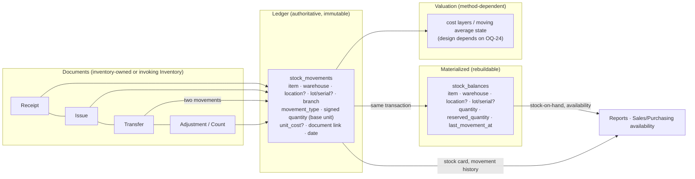

# Inventory Domain Analysis

Status: Proposed (design for review) · Updated: 2026-10-07 (C-61 boundary decisions and
C-59 as-built valuation reconciled; no production integration implemented)
Companion: [blueprint](./domain-blueprint.md) §5/§9 · [master data](./master-data-strategy.md) ·
ADR-0017 (proposed) · ADR-0022 (accepted) · ADR-0039 (proposed) · ADR-0041 · AR-13/16 ·
[PDR-09](../../decisions/product/PDR-09-inventory-accounting-posting-boundary.md) ·
OQ-24, OQ-29, OQ-31, OQ-67, OQ-68, OQ-69, OQ-70, OQ-71

Inventory answers one question with certainty: **how much of what is where, and what
did it cost**. This analysis decides where the truth lives, how balances stay fast,
and which parts are accounting decisions that must not be guessed.

---

## 1. The central question — where is the source of truth?

| Option | Description | Pros | Cons |
|---|---|---|---|
| **A. Balance is authoritative** | One row per (item, warehouse, …) holding `quantity`; movements are optional notes | Fast reads; simple mental model | No history (how did we get here?); corrections are silent edits; audit/legal failure; cannot value FIFO or explain differences; concurrent updates need careful locking with no compensating ledger |
| **B. Movement ledger is authoritative** | Every change appends an immutable movement; balances computed by `SUM` on demand | Complete history, auditable, correctable by counter-movements, natural valuation input | Naive `SUM` over millions of rows is slow for "stock on hand" screens and availability checks; every read pattern must be indexed carefully |
| **C. Movement ledger **+** materialized balance** (recommended) | Movements are authoritative; a balance row per key is maintained **in the same transaction**, rebuildable from the ledger | History + audit + fast reads; reconciliation is a routine query ("rebuild balance, compare"), not a rescue operation | Two structures to keep consistent (mitigated by one-transaction update + rebuild tool + reconciliation report) |

**Recommendation: C.** It is the only option that satisfies both the audit/legal
requirement (AR-13: movements immutable, corrections as counter-records) and the
operational requirement (stock screens, availability checks, reports) without
sacrificing either.

**Non-negotiables that follow from C:**

1. Movements are **append-only**. No `UPDATE`, no `DELETE` (except in a documented
   administrative purge that requires an ADR — and it would break valuation, so it is
   not planned).
2. The balance is **derived data**: it may be rebuilt from scratch at any time; a
   nightly/periodic reconciliation job compares ledger vs balance and reports drift
   (drift is a bug or a hand-edited database, never a business event).
3. Balances are updated with row-level locking (`SELECT … FOR UPDATE` on the balance
   key — `database-strategy.md` §13) inside the movement's transaction.
4. Every movement carries `correlation_id`, `created_by`, `document_id` (when it came
   from a document) and the movement type.

---

## 2. The model

### 2.1 Movement fields (shape, not DDL)

| Field | Notes |
|---|---|
| `id`, AR-12 columns | standard |
| `item_id` | must be `is_stockable` |
| `warehouse_id`, `location_id?` | location only when the warehouse tracks locations |
| `branch_id` | derived from the warehouse; stored for reporting/indexing |
| `lot_id?`, `serial_id?` | required when the item's capability requires it |
| `movement_type` | closed enum: `opening`, `purchase_receipt`, `sales_issue`, `transfer_out`, `transfer_in`, `return_in`, `return_out`, `adjustment_gain`, `adjustment_loss`, `production_in`, `production_out`, `consumption`, … |
| `quantity` | **signed** in the item's base unit (`+`in, `−`out); balances are `SUM`-consistent by construction |
| `total_cost?` | **AS BUILT (ADR-0039): `total_cost` only — there is NO stored `unit_cost`.** A per-unit figure is a rounded presentation of `total_cost / base_quantity` and would become a second, divergent truth; it is derived on read at scale 6. `total_cost` is SIGNED exactly like `base_quantity` (inbound `+`, outbound `−`), so inventory value is `SUM(total_cost)` just as on-hand is `SUM(base_quantity)`. NULL means "this fact carries no value yet" — a legitimate, operational state (OD-VAL-05), not an error |
| `valuation_status`, `valuation_source`, `valued_at`, `valuation_run_id?` | **AS BUILT (ADR-0039):** finality of this row's value (`unvalued`/`provisional`/`valued`), where the value came from (`entered`/`average_cost`/`transfer`/`reversal`), when it was assigned, and which explicit repricing run last wrote it |
| `document_type`, `document_id`, `document_line_id?` | logical link to the originating document |
| `movement_date` | business date (drives period/opening filters) — distinct from `created_at` |
| `correlation_id`, `created_by` | audit trail (AR-23) |
| `reversal_of_movement_id?` | set when the movement is a counter-movement |

Signed quantity plus a closed type list gives both easy aggregation (`SUM(quantity)`)
and meaningful grouping (`GROUP BY movement_type`).

### 2.2 Balance key

`(item_id, warehouse_id, location_id, lot_id, serial_id)` with `NULLS NOT DISTINCT`
semantics for the optional parts (or a sentinel key) — one row per real stocking key.
`reserved_quantity` is a separate column (see §4), never folded into `quantity`.

---

## 3. Movements by source (who creates what)

| Source | Movement(s) | Notes |
|---|---|---|
| Opening balance | `opening` per item/warehouse | Entered as an explicit document dated before live operation *(OQ-23 links this to accounting opening balances — expert)* |
| Purchase receipt | `purchase_receipt` (+) | May include rejected quantity (no movement) and landed-cost allocation (expert) |
| Sales issue | `sales_issue` (−) | Created when a sales invoice/order issues stock (configuration decides the trigger — workflow doc) |
| Sales return | `return_in` (+) | Linked to the return document; valuation uses the original cost when the method requires it |
| Purchase return | `return_out` (−) | |
| Transfer | `transfer_out` (−) + `transfer_in` (+) | Same `transfer_id`; inter-branch transfers flagged (OQ-31) |
| Adjustment | `adjustment_gain` (+) / `adjustment_loss` (−) | Reason code required; approval per policy |
| Physical count | comparison produces adjustment document(s) | Counts are documents; the system never silently edits balances |
| Manufacturing (future) | `production_in` / `consumption` | Out of v1 scope; the movement vocabulary leaves room |

**Rule:** no module writes movements except Inventory (AR-08). Sales/Purchasing ask
Inventory to do it through a public command (see blueprint §10).

---

## 4. Reservations, availability and negative stock

- **Reservation** (soft claim, e.g. approved order): tracked as `reserved_quantity`
  on the balance row or as reservation rows, but **never** as movements (stock has
  not moved; valuation must not change). Whether v1 has reservations at all is a
  workflow/scope decision (OQ-26 dependency).
- **Availability** = `quantity − reserved_quantity` (at the chosen warehouse scope).
  Reports must state which definition they use; APIs return both numbers.
- **Negative stock policy:** physical negative inventory is **rejected for the MVP**
  (OD-VAL-17 / PDR-05). The older configurable `allow_with_permission` / `allow`
  alternatives below are not approved for MVP; they require a separate Owner decision.
  C-61 records that the current Item/Warehouse APIs still expose allow overrides that
  can permit negative physical stock; this is a known implementation discrepancy, not
  an approved exception, and is not fixed by C-61. The enforcement check for the
  approved reject path occurs inside the movement transaction, before the balance
  update. OQ-24 remains open for broader valuation/Accounting policy, not this reject rule.

---

## 5. Valuation — the Inventory-owned Accounting interface (partially decided, PDR-05)

Inventory owns valuation calculations and facts. PDR-05 / OD-VAL-02 and OD-VAL-18
select Moving Weighted Average as the **only active MVP method**; an unimplemented
method must not be offered or accepted. Additional methods require a separate decision.
The table below distinguishes the current method from future options:

| Method | What the model needs | Notes |
|---|---|---|
| Moving weighted average (perpetual) | Running quantity + value state per (item, warehouse) | **The only method implemented and executable in the MVP** (OD-VAL-02) |
| FIFO | Cost layers per receipt; outbound consumes layers in order; layer consumption must be recorded to allow reversal | Not implemented; the vocabulary reserves the name, the engine refuses it (OD-VAL-18) |
| Standard cost | Fixed standard cost + variance postings | Not implemented; needs variance accounts (expert) |

### 5.1 As built (ADR-0039 **Proposed** — implemented 2026-10-04, PR #116 open, not accepted)

OQ-24 was partially answered by Owner decisions **OD-VAL-01…OD-VAL-19**
([PDR-05](../../decisions/product/PDR-05-inventory-valuation-and-cost-optional-operations.md));
the implemented shape is:

| Concern | Decision as built |
|---|---|
| Method | Moving Weighted Average, perpetual, the only active one; `standard_cost`/`fifo` exist in the vocabulary and are rejected at configuration time with a typed 422 |
| Method configuration | `inventory.item_valuation_methods` — **organization + item**, **effective-dated** with the same versioning mechanism as `unit_conversions` (insert + supersede, never edit in place). Resolution is by the movement's **business date**, so a backdated document uses the method that was in force then |
| Valuation state | `inventory.inventory_valuation_states` — one row per **organization + warehouse + item**, the same key as the balance projection: `valued_quantity`, `total_value`, `uncosted_quantity`, `status`, `stale_since` |
| Value on the ledger | `inventory_movements.total_cost` (signed) + `valuation_status`/`valuation_source`/`valued_at`/`valuation_run_id`. No second ledger, no inventory-accounting document (OD-VAL-08) |
| Cost at posting time | **Optional, inbound only.** A receipt may carry `unitCost` *or* `totalCost` (never both) or nothing at all; an issue never takes an operator-entered cost (OD-VAL-05/07) |
| Stock with no cost | Physically real and visibly uncosted: it lands in `uncosted_quantity` and sets the key to `pending_cost`. It is **not** valued at zero |
| Late pricing | `POST /inventory/valuation/movements/{id}/cost` — an ADDITION to an `unvalued` inbound movement only; a movement that already carries a value is refused (409). Wrong values are corrected by reversal, like wrong quantities |
| Outbound value | Derived by the method: uncosted stock is consumed first, then the valued pool at its average; emptying the pool flushes the residual so zero quantity always means zero value |
| Transfers | Exactly value-neutral: out leg removes the source's share, in leg adds the identical amount (source `transfer`). Per-warehouse averages may legitimately diverge afterwards — **OQ-67, Resolved** (PDR-08 OD-TRF-01…03; a backdated transfer is valued by the coupled two-key replay since C-59C) |
| Reversals | Undo the value the **original** movement carried, read from the locked original row; degrade to `provisional` + `stale` when the pool no longer holds it — **OQ-68** |
| Backdating | Allowed, never silent: `backdateConfirmed` **and** a separate explicit `repricing` choice (`recalculate`/`skip`, no default). `skip` honestly persists a `stale` state rather than pretending (OD-VAL-10/11) |
| Recalculation | Deterministic replay of one key's history in the canonical ledger order (`movement_date, created_at, id`), bounded to one `(organization, warehouse, item)` key and `RECALCULATION_MOVEMENT_LIMIT` movements, audited in `inventory.inventory_valuation_runs` (OD-VAL-12). **The method is resolved per movement, at that movement's own business date** (OD-VAL-14): a 1404 movement is replayed under the 1404 configuration even when a newer version exists. A period configured with a method the MVP does not implement makes the replay fail closed (`inventory.valuation_method_not_implemented`) rather than be restated under Moving Weighted Average. The `method` column on the run/state row records the method in force for the key at execution time, not the per-movement methods applied — see **OQ-69** |
| Relationship to quantity | Strictly separate: the valuation strategy has no branch that rejects a posting. It either values the movement or records why it could not (OD-VAL-13) |

**Two invariants hold by construction and are asserted by the tests:**

1. `balance.on_hand == valuation_state.valued_quantity + valuation_state.uncosted_quantity`, always.
2. `SUM(movement.total_cost) == valuation_state.total_value` for every key that is not `stale`.

The second one is what makes `stale` meaningful: it is the *only* state in which the
stored value is knowingly allowed to disagree with the ledger, it is always the result
of an explicit human choice, and it is sticky until an explicit recalculation clears it.

### 5.2 Still expert-gated (OQ-24 stays OPEN)

The method, the *state* and the *operational* relationship between quantity and cost
are decided. Purchase Return and Sales Return **inventory valuation conventions**
were later decided in PDR-08; the Reversal convention is distinct. Still open are
broader Accounting/costing policies: COGS/journal policy and mapping (OQ-24/25),
transaction/atomicity and failure semantics for the synchronous posting contract (OQ-39),
Purchase Return agreed-price variance mapping (OQ-70), landed-cost allocation,
purchase-price variance, valuation money precision and currency (OQ-03/OQ-11 —
`numeric(18,2)` is interim), lot/serial-level valuation, write-down/NRV,
revaluation policy and manufacturing WIP.

### 5.3 C-61 Inventory → Accounting boundary (Owner-decided, not implemented)

[PDR-09](../../decisions/product/PDR-09-inventory-accounting-posting-boundary.md)
records PO-01…PO-12. Inventory is authoritative for quantity, movement, valuation
and valuation history; Accounting owns account mapping, journal construction,
voucher policy and financial posting. The primary internal integration is a
synchronous application-service call through explicit public contracts in the
Modular Monolith (ADR-0041), not an event subscriber or outbox delivery. Only
explicitly approved Inventory Business Documents may initiate posting; raw
movements, reservations, Material Requests and technical projections do not.

Eligibility requires an operational document, complete valuation, no relevant
stale valuation key, and applicable Accounting policy gates. Eligibility is not
posting evidence. After actual Accounting Post, direct valuation changes are
forbidden; Inventory/Accounting corrections remain independent but linked and
policy-open. The current Inventory `accounting_posted` flag is not a Voucher or
proof of Accounting posting. OQ-39/69/70/71/72 and the implementation gaps are
tracked in the C-61 package; no integration code is authorized here.

## 6. Lot / serial / expiry tracking

Enabled by **item capability** (`requires_lot`, `requires_serial`, `requires_expiry`),
never by a warehouse-wide flag alone:

- When required, every movement and balance row carries the lot/serial; the balance
  key includes it.
- **Serial** items have quantity 1 per stocking key (constraint enforced in code;
  database check where stable).
- **Expiry** uses the lot's expiry date; expiry reports are queries over lot/balance
  data, not a separate subsystem.
- **Traceability** (which customer received which lot/serial) is a query over
  movements + document links; regulated-industry requirements (retention,
  reporting) are expert-gated *(legal/inventory expert)*.

---

## 7. Reporting

| Report | Source | Shape |
|---|---|---|
| Stock on hand (by item/warehouse/group) | `stock_balances` (+ master data) | one row per stocking key; fast, indexed by `(warehouse_id, item_id)` |
| Stock card / movement history | `stock_movements` | filtered by item + date range; ordered by `movement_date, created_at` |
| Stock by movement type / period | ledger grouped by `movement_type`, `movement_date` | typed columns, no JSON |
| Valuation / inventory value | valuation state + master data | method-dependent view |
| Availability (for Sales/Purchasing) | balance − reserved | module-owned view/service |
| Reconciliation (ledger vs balance) | `SUM(movements)` vs `balances` | operational report; drift must be zero |
| Aging / slow-moving (later) | last movement date per key | extension |

All of these are plain SQL over typed columns — the design requirement from
`domain-blueprint.md` §13.

---

## 8. Risks and mitigations

| Risk | Mitigation |
|---|---|
| Balance drift under concurrency | One transaction per movement with a locked balance row; reconciliation query; rebuild tool |
| Valuation method changes or unsupported methods are assumed | Moving Weighted Average is the only active MVP method; method state is effective-dated and rebuildable (PDR-05); new methods require a decision |
| Fractional quantities/rounding | Base-unit storage, explicit conversions, precision config, expert sign-off (OQ-29) |
| Negative stock "temporarily" allowed | Reject physical negative inventory for MVP (OD-VAL-17); any future allowance requires a separate Owner decision |
| Lot/serial enforced inconsistently | Capability flags drive validation in one place (Inventory domain), not per document type |
| Cross-branch transfers treated naively | Same-Legal-Entity warehouse transfer has no GL Voucher (PO-06); other legal/entity/tax/financial-area scopes remain open (OQ-31) |

## 9. Decisions introduced here

- **D-04** Movements are the source of truth; balances are materialized in the same
  transaction and rebuildable (ADR-0017).
- **D-05** Movement vocabulary is a closed enum; signed base-unit quantities; every
  movement references its document and audit context.
- **D-06** Valuation method is Inventory-owned configuration consuming the ledger,
  not schema-shaping; Moving Weighted Average is the only active MVP method
  (OD-VAL-02/03/04/14/18, PDR-05). Broader Accounting effects remain open under OQ-24.
  *Implemented by ADR-0039: method configuration is effective-dated per organization
  + item, and only the **result** — the signed `total_cost` a movement actually carried
  — lives on the ledger row.*
- **D-07** Reservations are separate from movements and quantities; negative stock is
  a policy, defaulting to reject.
