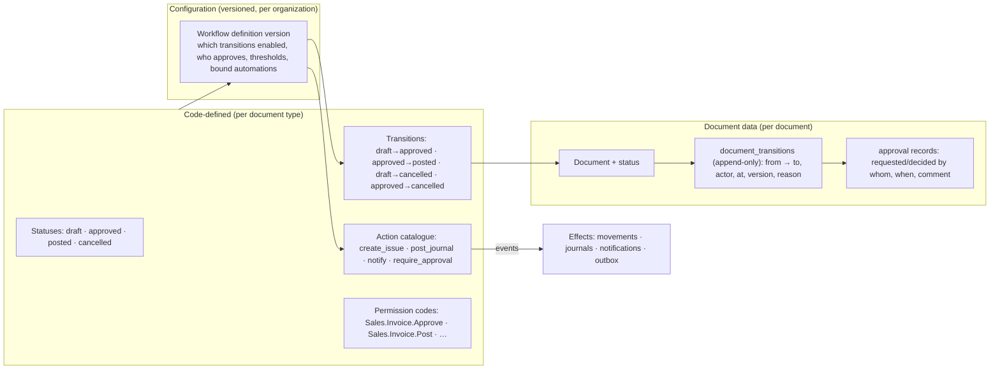
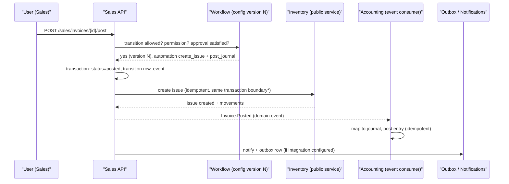

# Workflow Architecture

Status: Proposed (design for review) · Updated: 2026-09-11
Companion: [blueprint](./domain-blueprint.md) §8 · [documents](./document-architecture.md) ·
ADR-0018 (proposed) · ADR-0006/0016 (RBAC) · OQ-26, OQ-14, OQ-27

This document defines how a business configures *its own* document flows without
Vardena becoming a low-code workflow platform. The core idea: **structure is code,
selection is configuration, history is recorded.**

---

## 1. The concepts, separated

The task lists eight concepts that are frequently collapsed into one table. In
Vardena they are distinct, and each has exactly one home:

| Concept | Definition | Home | Who changes it |
|---|---|---|---|
| **Status** | Where a document is (`draft`, `approved`, `posted`, `cancelled`, `closed`) | Code: a closed enum per document type | Nobody at runtime (code change + ADR) |
| **Transition** | An allowed edge between statuses (`draft → approved`) with effects | Code: the document type's transition table | Nobody at runtime; configuration **enables/disables** edges |
| **Permission** | RBAC code(s) required to perform a transition | Code registry (AR-22) + role assignments | Administrators assign roles; configuration binds a permission to a transition |
| **Approval** | A recorded decision that a transition may proceed for *this* document (conditions, threshold) | Configuration (workflow version) + `document_transitions` audit rows | Configuration decides *whether*; actors decide *this document* |
| **Business rule** | A condition in a bounded, code-supported vocabulary (amount > X, partner in group, warehouse in branch, credit exceeded) | Configuration condition rows, evaluated by code | Configuration, within supported condition keys |
| **Automation** | A registered action triggered by an event or a transition (create a linked document, post, notify) | Code: action catalogue; configuration: trigger binding + parameters | Configuration selects from the catalogue |
| **Domain event** | The fact that something happened (`Invoice.Approved`, `Invoice.Posted`) | Code: event schemas; emitted in the transaction | Nobody; events are facts |
| **Side effect** | The effect of an automation (movement, journal, notification, outbox row) | Owning module of the effect | Nobody (idempotent, audited) |

**Why the separation matters:** statuses must be enumerable for reports and
permissions; transitions must be auditable; approvals must be evidence, not state
flags; automations must be idempotent and replay-safe. Collapsing them into one
"workflow JSON" makes every one of those guarantees impossible.

---

## 2. The model



### 2.1 Status sets are code

Each document type declares its states in code, e.g.:

```
Sales.Quotation        draft → sent → accepted | rejected | expired | cancelled
Sales.Order            draft → approved → partially_fulfilled → fulfilled | cancelled
Sales.Invoice          draft → approved → posted | cancelled
Inventory.Receipt      draft → approved → posted | cancelled
Accounting.Journal     draft → approved → posted | reversed
```

These sets are **complete for v1**; adding a state is a code change with an ADR (it
changes the meaning of reports, permissions and automation). No configuration can
introduce a state.

### 2.2 Transitions are code; their *enablement* is configuration

For every legal edge the code declares: source status, target status, the side
effects it performs, and the default permission. A **workflow definition version**
then says, for the organization:

- which edges are **enabled** (e.g. some businesses have no approval step: `draft →
  posted` directly);
- which **permission** is required (within the codes the document type declares);
- whether an **approval** is required, with conditions (threshold, partner group,
  branch, item group) and who may approve (permission code);
- which **automations** are bound to the transition (from the registered catalogue),
  with typed parameters.

Example (configuration rows, not code):

| Document type | Edge | Enabled | Approval condition | Bound automation |
|---|---|---|---|---|
| `Sales.Invoice` | `draft → approved` | yes | `total > 100_000_000` requires `Sales.Invoice.Approve` | — |
| `Sales.Invoice` | `approved → posted` | yes | — | `create_issue` (if stockable lines), `post_journal` |
| `Sales.Order` | `draft → approved` | yes | always requires `Sales.Order.Approve` | — |
| `Sales.Order` | `approved → partially_fulfilled` | yes | — | — |
| `Inventory.Receipt` | `draft → posted` | yes (no approval in this business) | — | `create_movements` |

### 2.3 Transition history is append-only

Every status change writes a `document_transitions` row:

`id, document_type, document_id, workflow_version_id, from_status, to_status,
actor_id, occurred_at, reason?, correlation_id, approval_id?`

This is the audit trail the Audit module consumes (AR-23) and the source for
"who approved what, under which configuration version" reports.

### 2.4 Approvals are records

An approval is a row (or a small set of rows for the future multi-level case) with
`document_id`, `required_permission`, `requested_at/by`, `decided_at/by`, `decision`,
`comment`, `workflow_version_id`. Approval is **not** a boolean on the document
(that loses who/when/under-what-rule). A document may need approval at several
transitions; each is a separate record.

### 2.5 Automations are a registered action catalogue

Actions are code, each with a typed parameter schema, e.g.:

| Action | Effect | Idempotency key |
|---|---|---|
| `create_issue` | Ask Inventory (public service) to create an issue for the stockable lines | `(source_document_id, action)` |
| `create_receipt` | Ask Inventory to receive goods for a purchase document | same pattern |
| `post_journal` | Ask Accounting to post the mapped journal for this document | `(source_document_id, event_id)` |
| `reserve_stock` / `release_reservation` | Inventory reservation operation | `(document_id, line_id)` |
| `notify` | Notifications module: recipients (role/permission) + template | `(document_id, transition, recipient)` |
| `enqueue_outbox` | Write an outbox row for an external system (AR-14) | `dedup_key` |

Automations triggered by **domain events** use the existing event machinery and must
be idempotent (AR-15). Automations bound to a **transition** run inside the same
transaction as the transition (so a failure rolls the transition back) and are
recorded; those that must reach external systems write outbox rows in that
transaction (never an HTTP call, AR-14).

### 2.6 Business rules (conditions) are bounded

Supported condition vocabulary for v1 (code-supported, validated, indexed where used):

- numeric comparison on document totals or line amounts (`total > X`, `line.quantity
  > Y`), with an explicit currency;
- equality/membership on dimension ids (`branch_id ∈ …`, `item_group_id ∈ …`,
  `party_id ∈ group`, `warehouse_id ∈ …`);
- date comparison (`document_date` within a period, relative to today);
- capability/attribute lookups on the referenced master record, restricted to a
  whitelisted attribute set per document type;
- user/permission predicates (`actor has permission X`, `actor ≠ creator` for
  separation of duties).

**Explicitly not supported:** free-form expressions, scripts, loops, external calls,
cross-document graph traversal beyond declared relations. A rule that cannot be
expressed with these primitives requires a code change (and a review) — that is the
intended bound.

---

## 3. Versioning (ADR-0018)

- A **workflow definition** is a named container per (organization, document type).
- It has **versions** (`draft` → `published` → `superseded`), immutable once
  published; the published version carries `effective_from`.
- Exactly **one version is active** per document type at a time (effective dating);
  overlapping activation windows are a validation error.
- Every **document stores `workflow_version_id`** at creation (and each transition
  row stores it too, so a document migrated between versions keeps a truthful history).
- **In-flight documents** (created under version N, still open) keep version N by
  default. Configuration may require them to move to version N+1; that migration is
  an explicit, audited action (who, when, how many documents), never an automatic
  reinterpretation.
- **Draft versions** can be simulated/tested against sample documents before publish;
  publishing is permission-gated (`Organization.Workflow.Publish` — code registered by
  the Organization module).
- Rollback = publish a new version equal to the old one (versions are immutable; no
  in-place edits), so the audit trail explains every change.

**Historical integrity guarantee:** changing a workflow never changes what an already
recorded document means; it changes what may happen *next* to documents that are still
open and to documents created afterwards.

---

## 4. Minimum viable workflow (v1 scope)

| Capability | v1 | Extension (later, needs its own design) |
|---|---|---|
| Statuses & transitions | Code-defined per document type | New states/types via code + ADR |
| Enable/disable transitions | Configuration | — |
| Permission per transition | Configuration (from declared codes) | Scope-aware permissions (per branch) |
| Approval | **Single-level**, condition-bounded, recorded | Multi-level chains, parallel approvals, quorum |
| Delegation (out-of-office) | No | Later: time-boxed delegation records |
| Escalation on timeout | No | Later: reminder + escalation rules on the job queue |
| Automations | Closed catalogue, bound to transitions/events | New actions via code (registry) |
| Conditions | Bounded vocabulary (§2.6) | More primitives as real needs appear |
| Versioning | Versioned, effective-dated, pinned per document | Scheduled activation, A/B testing (no) |
| Delegation of authority | Not in v1 (OQ-26) | — |

This is deliberately the smallest model that supports the task's three sample
businesses:

| Business | Configuration rows needed |
|---|---|
| A: `Quote → Approval → Invoice → Issue → Accounting` | Quotation enabled with approval on `sent`; automation `derive` invoice on acceptance; invoice posting automation `create_issue` + `post_journal` |
| B: `Order → Issue → Invoice` | Quotation disabled; order approval; order approval automation `create_issue`; invoice posting `post_journal` |
| C: `Invoice → Issue` | Order disabled; invoice `draft → posted` in one step; automation `create_issue` on approval, `post_journal` on posting |

---

## 5. Where approvals and permissions meet RBAC

- Permissions come from the code registry (AR-22); the workflow definition may only
  reference **declared** codes for that document type, e.g.
  `Sales.Invoice.Approve`, `Sales.Invoice.Post`, `Sales.Invoice.Cancel`,
  `Inventory.Receipt.Post`.
- The route guard + application service check the permission on the *action endpoint*
  (e.g. `POST /sales/invoices/{id}/approve`), while the workflow definition decides
  *which* permission that action requires for this organization — checked in the
  application service at transition time (a workflow-aware check, still
  `AuthorizationService`, ADR-0016).
- Separation of duties ("the creator may not approve their own document") is a
  condition, not a separate system; if configured, it is enforced in the service and
  recorded in the transition/approval rows.
- Role/approval baselines remain OQ-14 (no seeded roles) and OQ-26 (approval policy).

---

## 6. Interaction with documents, inventory and accounting (example)



\* Cross-module calls inside one DB transaction are allowed only through the owning
module's public application service, which participates in the caller's transaction
boundary when the platform supports it; where it cannot (worker/async path), the
automation is event-driven and idempotent instead. The choice per automation is part
of the action's registration, not of the configuration.

---

## 7. Audit, reporting and operations

- **Audit:** transitions, approvals, workflow version changes and configuration
  changes all emit domain events (AR-23) and are visible in the document's history.
- **Reporting:** reports can filter by status (declared enum) and by transition time
  (join on `document_transitions`) — e.g. "invoices approved but not posted for >2
  days", "orders awaiting approval". Pending-approval worklists are queries, not a
  separate subsystem.
- **Operations:** workflow configuration is data; it is included in configuration
  export/import (deployment tooling, flagged as R3) and diffed between environments.

---

## 8. Anti-patterns avoided

| Temptation | Why avoided |
|---|---|
| Generic BPMN-style engine with user-drawn graphs | Unbounded scope, unreviewable logic, no type safety, testing nightmare (§ blueprint 17) |
| Workflow state stored only as a string on the document | No history, no "who approved under which rule", no pending-approval worklists |
| Approvals as a boolean flag | Loses actor/time/rule; audit cannot answer the obvious questions |
| Automations as arbitrary user scripts | Security and determinism; actions come from a registered catalogue |
| Coupling workflow to UI | The engine is server-side; the UI only renders available transitions |
| Per-customer state machines in code | Configuration over code-defined edges is the entire point |

## 9. Decisions introduced here

- **D-15** Statuses/transitions/permissions are code; enablement, approval conditions
  and automation bindings are versioned configuration (ADR-0018).
- **D-16** Documents pin their workflow version; configuration changes never
  reinterpret history (ADR-0018).
- **D-17** Automations come from a registered action catalogue and are idempotent;
  no scripting (ADR-0018).
- **D-18** Approval model is single-level in v1 with recorded decisions; multi-level
  and delegation are extension points (OQ-26).

---

## 10. As-built notes (Task 9, 2026-09-12)

The implementation binding lives in ADR-0024 and
`docs/task-9-implementation-report.md`. Concrete choices worth recording
against the design above:

- **Consuming surface:** 18 REST paths under `/api/v1/workflow` and 10
  `Workflow.*` RBAC codes (`Definition.{View,Create,Edit}`,
  `Version.{View,Create,Edit,Publish}`, `Instance.{View,Bind,Execute}`).
  Transitions additionally name their own `required_permission` (any
  registered code); the service re-checks both — D-15's "permissions are
  code" holds at execution, not just at the guard.
- **Events:** `WorkflowVersion.Published`, `WorkflowInstance.Bound`,
  `WorkflowTransition.Completed`, `WorkflowApproval.Decided` on the existing
  in-memory bus. The Completed event carries bound automations as
  `[{ action, parameters }]`; executing them is future work (outbox/worker).
- **Staleness:** approvals pin `base_sequence` (history length at request);
  deciding or executing after the workflow moved fails with 422. The
  concurrency loser of two transitions fails with 409 (`not_in_source_state`).
- **No version PATCH, no history mutation routes, no `code`/endpoint updates.**
  Immutability is structural (missing routes/fields), not just validated.
- **Bindings are `(entity_module, entity_type, entity_id)`** with a ULID id —
  the §6 document example binds as e.g. `('accounting', 'invoice', '<ulid>')`
  with no FK into business tables.
